# OneTrust — Auth revision (diagrams + Q&A)

**Use this to revise.** Deep dump stays in [ONETRUST_AUTH_FLOW.md](./ONETRUST_AUTH_FLOW.md). SSO: [ONETRUST_SSO.md](./ONETRUST_SSO.md). Iframe: [ONETRUST_IFRAME_BRIDGE.md](./ONETRUST_IFRAME_BRIDGE.md).

Say **IDMS NUX + auth-server**. Do not name laptop folders.

---

## Cheat sheet (numbers)

| Clock | What | Value |
|---|---|---|
| Access token | Absolute life from issue | **10800 s = 3 hours** (`idms` client). FE has **no timer**. Next API **401** → refresh. |
| Refresh token | Absolute life | **2147483647 s** ≈ 68 years. **Not a real TTL.** Dies on **revoke / logout / missing store row**. |
| Session idle | Inactivity | Tenant `timeout.seconds`. Global seed **86400 s = 24 h**. FE fallback if missing: **30 min**. |
| Session `updated` write | DB throttle | **30 min** (`session.update.threshold`). Not the logout clock. |
| Max parallel sessions | Concurrent browser logins | **`-1` = unlimited**. Tenant can set e.g. 2 → oldest sessions deleted. |

**Sliding idle:** keep using the app → `updated` slides → **idle does not fire**. Walk away 24 h → next validate + FE timer → **logout**. Refresh does **not** revive idle.

**Not JWT in the browser.** Dashboard tokens are **OAuth2 token-store** strings + `expires_in`. UI does not decode `exp`.

---

## 1. Whole map (start here)

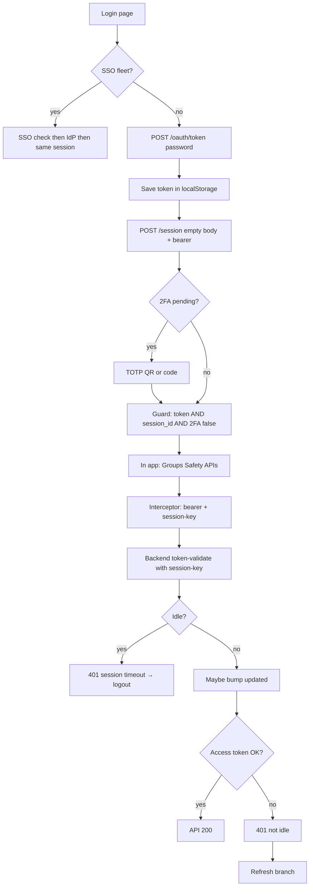

SSO detail: file **17**. This file is password + session + 401.

---

## 2. Login branch

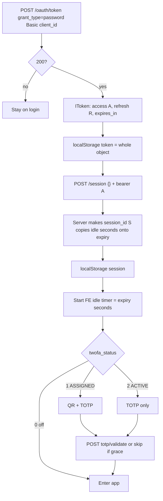

**Q: Token then session — is that right?**  
Yes. Token first. Session second. Interceptor then puts **both** on every product call.

**Q: Who invents `session_id`?**  
**Auth-server**, not the FE. Hash of username + time. FE only stores what POST returns.

**Q: Same access token on another device?**  
**No.** Each login mints **its own** A and R. Devices share **user**, not tokens. Max-sessions can **kill old S**, not clone A.

---

## 3. Does every API call the session API?

**No `POST /session` on every Groups/Safety call.**  
POST = create login. PUT = after **access refresh**, bind new A to S.

**Yes, almost every dashboard API hits session *check*:**

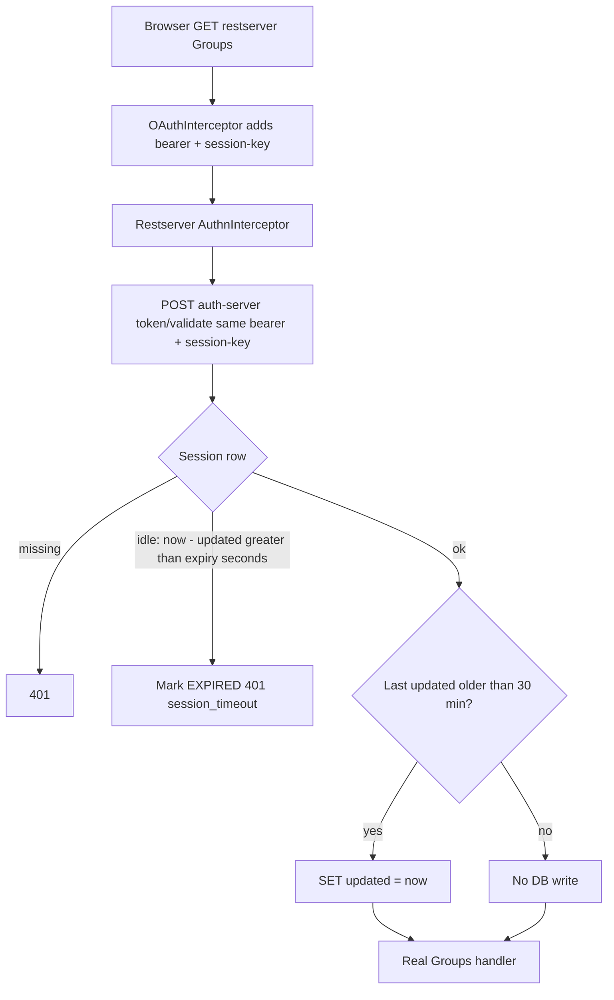

**Q: Does every API update `updated`?**  
**Checks** almost always. **Writes** only if last bump is older than **~30 minutes**.

**Q: How does backend know expired?**  
**Lazy.** Next validate. No cron. Formula: `updated` older than `now - expiry seconds`.

**Q: Mouse vs API idle?**  
FE timer slides on **mouse/keyboard**. Server slides on **validate**. Mouse-only, no APIs: FE may logout while server `updated` is stale until the next call (that call would also fail idle).

---

## 4. Two clocks (do not mix)

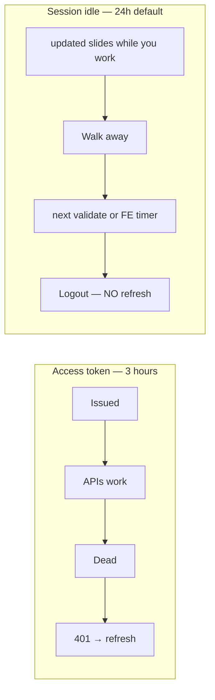

| Field | Object | FE uses it? |
|---|---|---|
| `expires_in` | Token | **Stored only.** No `setTimeout`. Backend 401. |
| `session.expiry` | Session | **Yes.** `setTimeout(expiry * 1000)` → logout. Slide on activity. |
| `session.updated` | Session | **Server** idle. FE does not compute from it. |

**Q: Keep updating — does session still expire?**  
**Idle: no**, if you keep using it. **Still can die:** logout, max sessions, refresh revoked.

**Q: Session expired — refresh it?**  
**No.** Login again. PUT session is **not** “revive idle.”

---

## 5. 401 — first branch (the important fork)

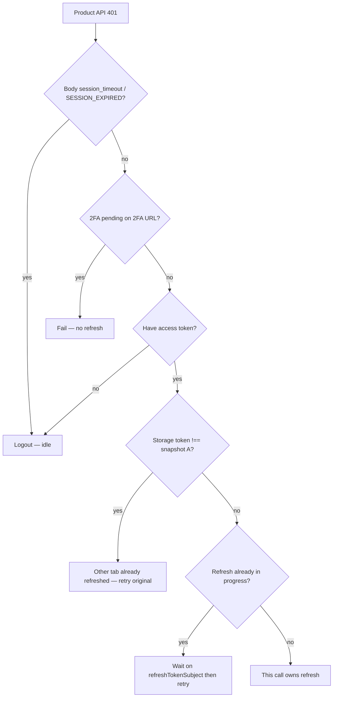

Idle 401 **never** goes to `/oauth/token` refresh.

---

## 6. Refresh branch (access dead, session still alive)

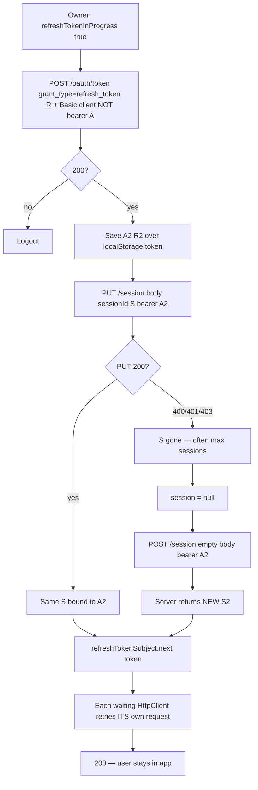

**Q: After 401 which APIs run again?**  
Not a global URL list. Each HttpClient Observable **stayed open**. Interceptor **retries that `HttpRequest`**. Two 401s = two retries after **one** token POST.

**Q: What is `refreshTokenSubject`?**  
A **doorbell** (`BehaviorSubject`), not a queue of URLs. Waiters: `filter(token != null)`, `take(1)`, then retry.

**Q: PUT failed — you said logout, now POST?**  
Idle timeout = logout. **PUT 0 rows after a successful refresh** = old S inactivated, **A2 is already good** → **POST new session**. Different branch.

**Q: What do we send on that POST?**  
**Empty body.** Bearer **A2**. Server generates **S2**. We do not invent the id.

**Q: Cross-tab — 401 body send A2?**  
**No.** Other tab wrote **localStorage**. This tab `getItem` sees A2. Compare to snapshot A taken at request start → retry, do not second-refresh (R may have rotated). `storage` event is **other documents only**; same-tab read is just `getItem`.

---

## 7. Max parallel sessions

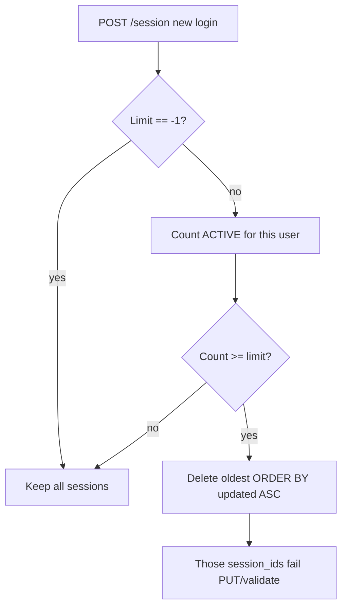

Default **unlimited**. If tenant sets 2: third login kills least-recently-updated.

---

## 8. Auth guard (not 401)

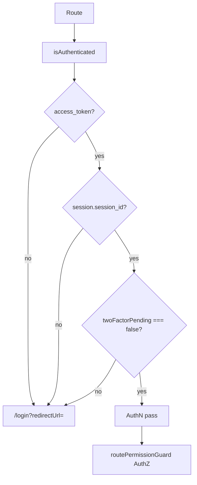

Guard does **not** decode JWT `exp`, does **not** call `/oauth/token`, does **not** check idle `updated`. Permissions are a **second** guard.

---

## 9. Why token + session (one picture)

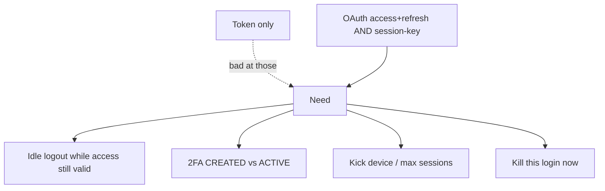

**Worth it for IDMS:** B (token + session). JWT-only is for stateless public APIs. **Next:** HttpOnly refresh cookie (XSS tax today because **three UIs** share `localStorage`). CSRF is the cookie tax.

OAuth **2**, not 1.

---

## 10. 2FA — UI, APIs, “is the QR scanned?”

**Not SMS.** TOTP: 6–8 digit code from Google Authenticator (etc.). Password is factor 1. Code is factor 2. Admin turns it on in **Portal Users**.

**We never get a “QR scanned” callback.** The phone app is offline. The only proof is: user types a code that matches the **shared secret**. First success: `twofa_status` 1 → **2**, session **CREATED → ACTIVE**.

### After password — which UI?

`POST /session` returns `user.twofa_status`. Login page reads that (not a separate “is 2FA on?” API).

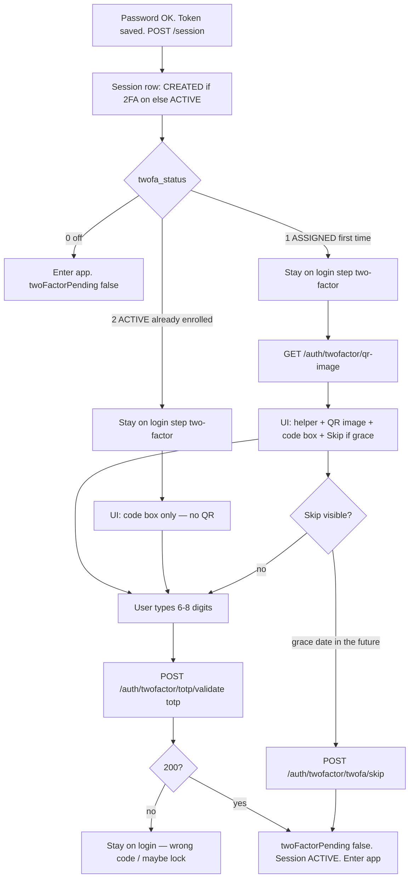

**SSO password-skip:** after IdP, FE sets `viaSsoLogin` and **does not** show this step (legacy). IdP was the other factor.

### What we send / get (all three 2FA URLs)

Same headers as other auth calls: **`Authorization: bearer A`** + **`session-key: S`**. Session is still **CREATED**. These three URLs are allowlisted: interceptor does **not** 401→refresh/logout on them. Groups/Safety would fail — guard never lets you there yet.

| Call | When | Body | Response | What UI does |
|---|---|---|---|---|
| `GET …/auth/twofactor/qr-image` | Only status **1** | none. `Accept: image/png` | **200** PNG as **base64 bytes** (arraybuffer) | Convert to `data:image/png;base64,…` and show ``. Loading / error / **Retry** if GET fails. |
| `POST …/auth/twofactor/totp/validate` | Submit code | `{ "totp": 123456 }` number 6–8 digits | **200** success message. **400** wrong code (or account locked after max attempts) | 200 → pending **false**, enter app. 400 → stay on 2FA, show error. |
| `POST …/auth/twofactor/twofa/skip` | Skip button | `{}` | **200** if `twofa_grace_period` **after now**. Else 400 | Same as success: pending **false**, session **ACTIVE**. User is still **ASSIGNED** until a later TOTP enroll. |

**QR GET does not mean enrolled.** It only paints the secret as a QR (`otpauth://` for the authenticator). Scanning happens **on the phone**. We never hear about the scan.

### How we “know” it is scanned / enrolled

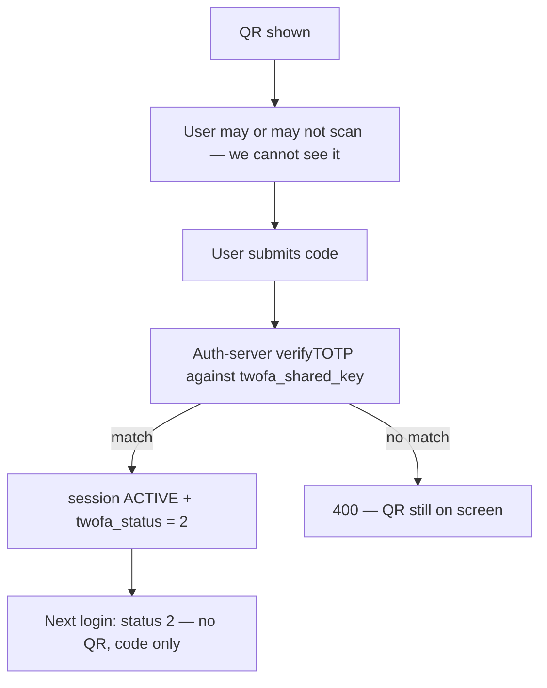

If they scanned but never typed the code: still **ASSIGNED**, still **CREATED**, still on login. Scan is invisible to us.

### `twoFactorPending` (memory only)

Password click → **true** immediately so `authGuard` cannot treat token+session as “in the app” mid-login. Validate/skip **200** → **false**. Password fail → **false**. Not stored in `localStorage`.

### Spoken ~30s

> After password we already have a token and a session, but if twofa_status is 1 or 2 the session is CREATED and the guard stays out. Status 1 we GET a QR image with bearer and session-key — we do not know if they scanned it. They type the TOTP, we POST validate, server checks the shared secret, flips session ACTIVE and status 2. Status 2 next time is just the code box. Skip exists only during grace. SSO skips our TOTP.

---

## Q index (your questions → one line)

| You asked | Answer |
|---|---|
| How do we get / save / refresh? | Token POST → save → session POST → save. Refresh **only on 401**, not a timer. |
| Is refresh_token saved? | **Inside** `localStorage['token']`. No separate key. |
| What does auth guard check? | Token **and** `session_id` **and** not 2FA pending. |
| Do we use token/session expiry dates on FE? | Token `expires_in`: **no timer**. Session `expiry`: **idle setTimeout**. |
| What does auth-server do with `updated`? | Idle check + maybe slide timestamp on validate. |
| Session expired — refresh session? | **Logout.** |
| 401 step by step? | Fork idle vs refresh. Refresh = token POST then PUT session then retry. |
| PUT 400 then POST — vs logout? | After **successful** token refresh if S is gone. Idle never gets here. |
| How do we get new session id? | **POST /session** empty + A2. Server returns S2. |
| Other tab already refreshed? | Snapshot A vs `getItem` now. Retry. Don’t double-refresh. |
| How do we know which APIs to replay? | Each Observable retries **itself**. Subject is a doorbell. |
| Two APIs 401? | First owns refresh. Second waits. Both retry. |
| Why not JWT only? | Idle, 2FA, kick device, revoke-now. |
| OAuth 1 vs 2? | We use **OAuth 2**. |
| Token same on other device? | **No.** |
| Every API POST session? | **No.** Validate + throttled `updated`. |
| Session limit / keep updating? | Idle **24h** default, slides. Parallel default **-1**. |
| JWT / refresh expiry? | Access **3h**. Refresh **~never** unless revoked. |
| 2FA UI / QR scanned? | Status 1: GET QR + code. Status 2: code only. **No scan webhook** — only TOTP validate proves it. |

---

## Spoken 45s (open with this)

> OAuth2 password grant, then POST session. We send bearer and session-key on every dashboard API. Access lives three hours — 401 then refresh token, PUT session, retry. Idle is a separate 24-hour inactivity window on the session row; we do not refresh that, we log out. Parallel sessions default unlimited. Refresh token is practically non-expiring until revoke.
