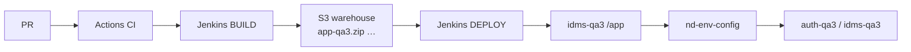

# OneTrust — CI/CD (one picture)

**Related:** [ONETRUST_MFE_AUTH.md](./ONETRUST_MFE_AUTH.md) (host vs remotes auth) · [ONETRUST_JENKINS_ENV_DEPLOY.md](./ONETRUST_JENKINS_ENV_DEPLOY.md) · [ONETRUST_ENVIRONMENT_STORY.md](./ONETRUST_ENVIRONMENT_STORY.md) · [ONETRUST_BUILD_DEPLOY_ENVS.md](./ONETRUST_BUILD_DEPLOY_ENVS.md)

**“Explain current CI/CD + Nx/MFE target” (spoken + both diagrams):** [ONETRUST_CICD_NX_MFE.md](./ONETRUST_CICD_NX_MFE.md)

**Do not say** laptop folder names.

---

## 0. 40s opener

> **CI** is GitHub Actions on every PR — lint, dashboard compile, security. Automatic. Nothing goes live.  
> **CD** in the company sense (merge auto-deploys QA) we **don’t have yet**. A human runs Jenkins **BUILD**, then Jenkins **DEPLOY** for one env.  
> BUILD compiles Angular **once**, stamps **one zip per env**, stores them in **`netradyne-artifacts`** (warehouse, not the website). DEPLOY downloads **`app-qa3.zip`** and unpacks onto qa3 CDN + `/app`.  
> Env for **APIs** is **not** “the zip name.” `index.html` has a script **we wrote** (`#nd-env-config`). On `idms-qa3` it reads the **hostname** → name `qa3` → `auth-qa3` / `idms-qa3`. Jenkins only fills `BUILD_ENV` (fallback) and CDN `<script src>`.

---

## 1. Whole train

```text
  PR ──► GitHub Actions (CI) ──► merge
                                      │
                                      │  human starts job
                                      ▼
                         JENKINS BUILD  (Jenkinsfile-app-dashboard-frontend)
                         ng build ONCE → stamp 13 zips → artifacts S3
                                      │
                                      │  human starts job  ENV=qa3  BUILD=4821
                                      ▼
                         JENKINS DEPLOY  (not in dashboard git)
                         unzip app-qa3.zip → cdn-qa3 + idms-qa3/app
                                      │
                                      ▼
                         Browser runs #nd-env-config → then Angular APIs
```



| | Happening today? |
|---|---|
| **CI** (PR green/red) | **Yes** — Actions |
| **Artifact factory** | **Yes** — Jenkins BUILD (usually a click) |
| **Deploy to a farm** | **Yes** — second job, **manual** env pick |
| **Continuous Delivery** (merge → QA by itself) | **No** — company target |

---

## 2. Jenkins BUILD — steps

**File:** `Jenkinsfile-app-dashboard-frontend` · **Agent:** `build-fleet`  
**Params:** `BRANCH`, `HOTFIX_BUILD` (true = staging+prod only)

| # | Stage | What |
|---|---|---|
| 1 | Validate & Initialize | `ENVS` = qa1…qa10 + staging + demo + production (or hotfix pair). Git checkout. |
| 2 | setBuildName | UI `#4821 (release)` |
| 3 | buildApp | Node **22**. npm cache. **`node ci-build-all.js --zip-to WebContent <ENVS>`** |
| 4 | Create Build Artifacts | `buildinfo.txt` (`PROJECT=app-dashboard-frontend`) |
| 5 | Upload to S3 | `s3://netradyne-artifacts/jobs/<JOB>/4821/app-*.zip` |

Inside step 3:

```text
  ng build  ──────────────►  main-AB12.js   (ONCE — expensive)
       │
       ├─ copy + stamp qa3     →  app-qa3.zip
       ├─ copy + stamp staging →  app-staging.zip
       └─ copy + stamp prod    →  app-production.zip
```

Stamp = rewrite **`index.html` only** (see §4). JS hashes stay the same.

`BRANCH=release` also writes `release_build_info/buildnumber.txt` = `4821`.

---

## 3. Jenkins DEPLOY — steps

**No deploy Jenkinsfile in the NUX git repo.** It **consumes** the zips.

| # | Step |
|---|---|
| 1 | Params: **ENV=qa3**, **BUILD=4821** |
| 2 | Download **only** `…/4821/app-qa3.zip` |
| 3 | Hashed JS/CSS → `cdn-qa3.netradyne.com/app/` |
| 4 | `index.html` → `idms-qa3.netradyne.com/app/` |
| 5 | SPA fallback `/app/*` → `index.html` |

Does **not** run `ng build`. Does **not** touch qa7 or prod.

Rollback = deploy an **older** `app-qa3.zip`.

---

## 4. The script in `index.html` — what it does

**Where:** `dashboard/src/index.html` → `<script id="nd-env-config">`  
**Who wrote it:** **we did** (git). Angular copies it into dist.  
**Who does *not* create it:** Jenkins.

It runs in the **browser**, **before** Angular. It does **three jobs**:

```text
  1. Pick env NAME     qa3 | staging | production | development
  2. From the name, compute HOSTS
       qa3 →  auth-qa3.netradyne.com
              idms-qa3.netradyne.com
              cdn-qa3.netradyne.com
  3. Set window.EnvironmentData
       Angular getAuthRuntimeConfig() later joins
       origin + /authserver/api/v1  +  /oauth/token
```

**How the NAME is picked** (not “put origin into BUILD_ENV”):

```text
  window.location.origin
           │
           ▼
  looks like idms-qa3 / idms-staging / idms.netradyne.com ?
           │
     yes ──┴──► NAME = qa3 / staging / production     ← origin WINS
     no  ──┬──► NAME = localStorage  OR  BUILD_ENV  OR  'development'
```

On a real QA farm, **hostname decides APIs**. `BUILD_ENV` is ignored.

Then Angular:

```text
EnvironmentData
  → getAuthRuntimeConfig()
  → AuthenticationService  POST …/authserver/api/v1/oauth/token
  → GroupsApi              GET  …/restserver/api/v1/settings/…
```

### How Angular “uses” a script in `index.html`

Angular does **not** import that `<script>` like a `.ts` file. The **browser** runs it. Angular later reads whatever the script left on **`window`**.

```text
  Browser parses index.html
       │
       ▼
  <script id="nd-env-config">     classic inline — RUNS NOW
       window.EnvironmentData = { EnvironmentConfig: { AUTH_SERVER_ORIGIN: … } }
       │
       ▼
  <script src="main-AB12.js" type="module">   Angular CLI put this here
       bootstrapApplication(App)
       getAuthRuntimeConfig()
         reads window.EnvironmentData.EnvironmentConfig
```

What it **sets** (the object NUX cares about):

```javascript
window.EnvironmentData = {
  EnvironmentConfig: {
    ENVIRONMENT_NAME: 'qa3',
    AUTH_SERVER_ORIGIN: 'https://auth-qa3.netradyne.com',
    AUTH_SERVER_API_PATH: '/authserver/api/v1',
    REST_SERVER_ORIGIN: 'https://idms-qa3.netradyne.com',
    REST_SERVER_API_PATH: '/restserver/api/v1',
    // …
  },
  CDN_URL_ORIGIN: 'https://cdn-qa3.netradyne.com',
};
```

How TypeScript is allowed to see it — a **global type**, then a read:

```typescript
declare global {
  interface Window {
    EnvironmentData?: { EnvironmentConfig?: …; CDN_URL_ORIGIN?: string };
  }
}

window.EnvironmentData?.EnvironmentConfig   // the join happens in getAuthRuntimeConfig()
```

**CDN script (Bootstrap, maps SDK, …) — same idea, different payload**

```html
<script src="https://cdn.jsdelivr.net/npm/bootstrap@5.3.0/dist/js/bootstrap.bundle.min.js"></script>
```

Yes it **runs**. The browser downloads it and attaches a **global** (often `window.bootstrap`). Angular does **not** auto-wire it into components.

| | `nd-env-config` (ours) | Bootstrap CDN |
|---|---|---|
| What it puts on `window` | `EnvironmentData` (config object) | `bootstrap` (JS library) |
| How Angular uses it | Read `window.EnvironmentData` | You’d call `window.bootstrap.Modal(el)` or ignore JS and only use CSS classes |
| CSS | none | Need a **`<link rel="stylesheet">`** too — JS tag does not load CSS |
| Preferred in Angular | This pattern is **correct** for runtime env | Prefer `npm i bootstrap` / `angular.json` styles, or ng-bootstrap — not a random CDN in prod NUX |

`type="module"` Angular bundles are **deferred**. A classic `<script>` in `<head>` (no `type="module"`, no `async`) runs **before** `main.js`. That’s why env is ready when `getAuthRuntimeConfig()` first runs.

**Spoken ~20s:** “Scripts in index.html are the browser, not the Angular compiler. Our env script assigns window.EnvironmentData; TypeScript reads that window field. A Bootstrap CDN script would also attach to window — it isn’t an Angular import. We use the env pattern on purpose; we wouldn’t load Bootstrap from a CDN for NUX.”

---

## 5. What is `BUILD_ENV`? Who put it?

**In git:** `var BUILD_ENV = '';`  (empty on purpose)

**Who fills it:** Jenkins stamp — `ci-build-all.js` / `custom-builder.js`

```javascript
html.replace("var BUILD_ENV = '';", "var BUILD_ENV = 'qa3';");
// also: <script src="main-AB12.js">
//    →  <script src="https://cdn-qa3.netradyne.com/app/main-AB12.js">
```

| Piece | Who | When |
|---|---|---|
| The `<script id="nd-env-config">` block | Frontend in git | Always |
| `BUILD_ENV = 'qa3'` | Jenkins stamp | Per-env zip |
| CDN `src=` on JS/CSS tags | Jenkins stamp | Per-env zip |
| API host on `idms-qa3` | Script + **address bar** | Page load |

**Why a zip per env if origin wins for APIs?**  
Because **JS must load from that env’s CDN**. Prod zip has `cdn-production` in `<script src>`. Putting that zip on qa3 would run **prod CDN files** on the QA page. APIs might still hit qa3 (hostname); **assets would be wrong**. That is the zip’s real job.

`BUILD_ENV` is the **fallback** when the page is **not** `idms-*` (testing CloudFront / S3 preview).

---

## 6. Same runtime config on MFE? Yes — on the **host**, not copied into every remote

**Can we reuse `#nd-env-config` + `getAuthRuntimeConfig()` for micro-frontends?**  
**Yes.** That is the plan. Remotes must **not** each detect env again.

The page is still **one** tab: `idms-qa3/app/`. Remotes are **JS** loaded into that page, not a second website. The script already ran on the host `index.html`. `window.EnvironmentData` is already there.

| | Do this | Don’t |
|---|---|---|
| **Host (shell)** | Keep `#nd-env-config`. `getAuthRuntimeConfig()`. Provide `AUTH_API_BASE` / `REST_API_BASE` | Rebuild remotes per QA |
| **Kernel** | Own real login + interceptor (later). Read the same bases | Mock forever in prod |
| **Remotes** | `inject(REST_API_BASE)` + their own `/tenants/…/devices` | Import `window.EnvironmentData`, own `index.html` script, `environment.qa3.ts` |
| **`federation.manifest.json`** | Where **remote JS** lives (`cdn-qa3/…/remoteEntry.json`) | REST/auth URLs |

```text
  Host index.html  →  nd-env-config  →  EnvironmentData  →  getAuthRuntimeConfig()
         │
         ├─ provide AUTH_API_BASE / REST_API_BASE
         │
         ├─ kernel AuthService  POST  AUTH + /oauth/token     (same as today)
         └─ devices remote      GET   REST + /tenants/…/devices
```

**POC today:** kernel is still **mock** login (`sessionStorage`). No `nd-env-config` on the demo host yet. Next peel: **put this script on the host**, then wire tokens. Do **not** stamp 13 builds of devices — one devices SHA; host HTML/manifest change per env.

**Spoken ~20s:** “Same script on the host. Remotes inject the API base; they don’t resolve qa3 themselves. Manifest is only where the remote bundle is. That’s how one devices compile talks to every QA.”

---

## 7. Say this

**~25s CI/CD:** “CI is Actions on the PR. Jenkins build stamps one zip per environment into artifacts S3. A second job deploys one zip to that farm. That’s delivery, not continuous CD.”

**~25s script:** “The env script is in source index.html. It maps hostname to an env name, then to auth and IDMS hosts. Jenkins only stamps BUILD_ENV and CDN script tags so qa3 HTML loads cdn-qa3.”

**~20s MFE:** “Same config on the host. Remotes inject REST/auth bases. We don’t rebuild devices per QA. POC is still mock login; next peel is this stamp plus tokens.”
