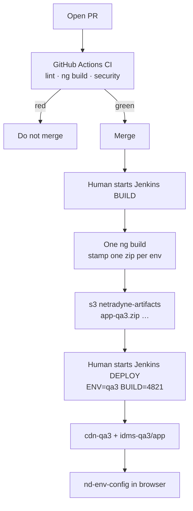
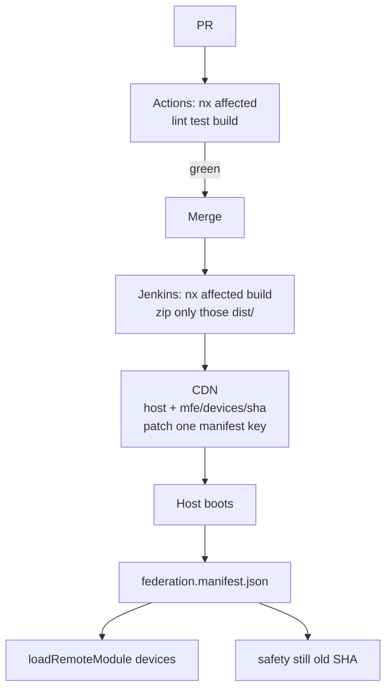

# Current CI/CD vs Nx + MFE — interview card

**Use this if he asks:** “Explain your current CI/CD.” · “How will CI/CD change with Nx and micro-frontends?”

**Do not say:** laptop folder names · POC · that merge auto-deploys QA · that Nx is in production today.

**Deep dumps (only if he drills):** env stamp → [ONETRUST_CICD.md](./ONETRUST_CICD.md) · Jenkins BUILD vs DEPLOY → [ONETRUST_JENKINS_ENV_DEPLOY.md](./ONETRUST_JENKINS_ENV_DEPLOY.md) · what Nx *is* → [ONETRUST_NX_MONOREPO.md](./ONETRUST_NX_MONOREPO.md)

---

## 0. Say this first (10s)

> Two different questions. **Today** is one Angular dashboard, one Jenkins zip per env. **Next** is host + remotes, same Jenkins/Actions, but **Nx affected** so we only compile and ship what the PR touched. GitHub Actions is still **CI**. Jenkins is still **not** continuous delivery.

| | Today (prod NUX) | Target (Nx + MFE) |
|---|---|---|
| **What ships** | One SPA zip `app-qa3.zip` | Host + `mfe/devices/<sha>/` + manifest |
| **PR checks** | Actions: lint / dashboard build / security | Same trigger: `nx affected -t lint,test,build` |
| **Release compile** | `ng build` **once**, stamp 13 env zips | `nx affected` → only those `dist/` folders |
| **Deploy** | Human picks ENV + BUILD number | Human still picks env; **sync only changed remotes** |
| **Nx in prod?** | **No** | Conversion pipeline |

---

## 1. Current CI/CD — whiteboard

Draw this. Talk while you draw.

```text
  developer PR
       │
       ▼
  ┌─────────────────────────────────────┐
  │  GitHub Actions   = CI              │
  │  on: pull_request                   │
  │  lint · dashboard ng build · security│
  │  green / red on the PR              │
  │  nothing goes live                  │
  └─────────────────────────────────────┘
       │ merge (human)
       ▼
  ┌─────────────────────────────────────┐
  │  Jenkins BUILD   (human starts)     │
  │  Jenkinsfile-app-dashboard-frontend │
  │  agent: build-fleet · Node 22       │
  │                                     │
  │  ng build ONCE                      │
  │       │                             │
  │       ├─ stamp qa3     → app-qa3.zip│
  │       ├─ stamp staging → app-staging.zip
  │       └─ stamp prod    → app-production.zip
  │                                     │
  │  upload → s3://netradyne-artifacts  │
  │           (warehouse, not the site) │
  └─────────────────────────────────────┘
       │ human starts DEPLOY  ENV=qa3  BUILD=4821
       ▼
  ┌─────────────────────────────────────┐
  │  Jenkins DEPLOY  (not in NUX git)   │
  │  download ONLY app-qa3.zip          │
  │  hashed JS → cdn-qa3 …/app/         │
  │  index.html → idms-qa3 …/app/       │
  └─────────────────────────────────────┘
       │
       ▼
  Browser → #nd-env-config → auth-qa3 / idms-qa3
```



**Words to use:**

- **CI** = Actions on the PR. Automatic. Quality gate.
- **CD** as “merge ships QA by itself” = **we don’t have that yet**.
- BUILD and DEPLOY are **two Jenkins jobs**. BUILD compiles. DEPLOY only unpacks **one** env zip.
- One compile, many zips: JS hashes are the same; `index.html` is stamped (`BUILD_ENV`, CDN `<script src>`). APIs on qa3 come from **hostname** in `nd-env-config`, not from “the zip name.”

### Spoken — current (~50s)

> On IDMS NUX, CI is GitHub Actions on every PR — lint, a dashboard compile, security. That’s automatic; nothing goes live. We don’t have continuous delivery: a human runs Jenkins BUILD on `build-fleet`, Node 22. That job compiles Angular **once**, then stamps a zip per env — `app-qa3`, `app-staging`, `app-production` — and parks them in `netradyne-artifacts`. A second Jenkins job, not even in the dashboard repo, deploys **one** of those zips to that farm. So CI is real; promotion is still a click. Hotfix BUILD only stamps staging and prod.

If he asks “why many zips if it’s one build?”  
> Same JS. Each zip’s HTML points at **that** env’s CDN. On the box, hostname still wins for API hosts.

---

## 2. Target — Nx monorepo + micro-frontends

Same **company train**. Different **payload**.

```text
  developer PR  (devices page only)
       │
       ▼
  ┌──────────────────────────────────────────┐
  │  GitHub Actions  = still CI              │
  │  checkout fetch-depth: 0                 │
  │  npx nx affected -t lint,test,build      │
  │       --base=origin/main                 │
  │                                          │
  │  git diff → graph → [devices]            │
  │  skip safety, video, admin               │
  │  illegal import remote→remote → lint red │
  │  check on the PR: quality/nx-affected    │
  └──────────────────────────────────────────┘
       │ merge
       ▼
  ┌──────────────────────────────────────────┐
  │  Jenkins BUILD  (human, same as today)   │
  │  nx affected -t build                    │
  │                                          │
  │  devices only:                           │
  │    dist/devices/browser →               │
  │    mfe/devices/<sha>/  + remoteEntry.json│
  │                                          │
  │  kernel changed:                         │
  │    rebuild host + ALL remotes            │
  │    (they all import @idms/kernel)        │
  └──────────────────────────────────────────┘
       │ DEPLOY still human, still one env
       ▼
  ┌──────────────────────────────────────────┐
  │  Sync ONLY what this BUILD produced      │
  │                                          │
  │  CDN:                                    │
  │    /                     host index.html │
  │    federation.manifest.json              │
  │      devices → …/mfe/devices/<sha>/…     │
  │      safety  → …/mfe/safety/<old-sha>/   │
  │    /mfe/devices/<new-sha>/               │
  │                                          │
  │  Safety URL in the manifest is unchanged │
  └──────────────────────────────────────────┘
       │
       ▼
  Browser: host loads · manifest · loadRemoteModule('devices')
  Env config stays on the HOST only (same nd-env-config)
```



**What Nx is doing in that picture (say it):**  
Not loading remotes. **Picking the list** for Actions and Jenkins.

**What Federation is doing:**  
Host fetches `remoteEntry` for Devices. Safety JS is not rebuilt.

**What does *not* change:**  
Actions still don’t ship customers. Jenkins DEPLOY is still a human. `nd-env-config` still lives on **host** `index.html`. Kernel is a **library**, not a URL.

### Spoken — target (~40s)

> Same CI and CD shape — Actions on the PR, Jenkins for artifacts, a second job to promote. The difference is the dashboard is host plus remotes. Actions run `nx affected` against the PR base, so a Devices PR only lints and builds Devices, and a remote-to-remote import fails the check. After merge, Jenkins builds that same affected graph and uploads `mfe/devices/<sha>/`, then we patch **that one key** in `federation.manifest.json`. Safety keeps its old SHA. Kernel change is the expensive PR — every consumer rebuilds, and that’s intended.

---

## 3. Nx on Actions vs Jenkins BUILD vs Jenkins DEPLOY

**Yes — Nx is the right tool for GitHub Actions.** That is the PR quality gate. `nx affected` needs **git + the graph**. Deploy does **not**.

| Job | Runs Nx? | Why |
|---|---|---|
| **GitHub Actions** (PR) | **Yes** | Diff vs `main` → lint/test/build only affected. Check goes green/red. |
| **Jenkins BUILD** | **Yes** (compile) | Same graph → produce `dist/` + upload artifacts. |
| **Jenkins DEPLOY** | **No** | Only **downloads a zip already built** and copies it to that env’s CDN. No source, no graph. |

Today is already this split: BUILD compiles, DEPLOY unpacks `app-qa3.zip`. After MFE, **same split**. Nx does not move into DEPLOY.

```text
Nx lives HERE                          Nx does NOT live here
─────────────────                      ─────────────────────
Actions:  nx affected -t lint,test     DEPLOY: aws s3 sync
Jenkins BUILD: nx affected -t build         or unzip tarball
               → artifacts S3              ENV=qa3  ARTIFACT=mfe-devices-abc123.tgz
```

### If we keep **one** BUILD job + **one** DEPLOY job (closest to today)

Same as now: human starts BUILD, human starts DEPLOY with `ENV=qa3` + `BUILD=4821`.

```text
Jenkins BUILD #4821
  nx affected → [devices]
  upload:
    mfe-devices-abc123.tgz
    affected.json  = ["devices"]     ← shopping list for DEPLOY

Jenkins DEPLOY  ENV=qa3  BUILD=4821
  read affected.json
  download mfe-devices-abc123.tgz
  sync → cdn-qa3 …/mfe/devices/abc123/
  patch federation.manifest.json  devices → that SHA
  do NOT touch safety
```

DEPLOY never calls Nx. It trusts the **artifact list** BUILD already wrote.

### Direct S3 (conversion script) — no zip warehouse

Prod NUX parks zips in `netradyne-artifacts`. The MFE conversion script does **not**: it **`ng build` then `aws s3 sync` straight to the testing CDN** (`…/mfe/devices/`). That script is **one shot** today (build + deploy). Split it into Jenkins jobs. **Nx still does not run on the sync.**

```text
TODAY (one script)
  deploy-to-s3.sh devices --apply
       =  ng build devices
       +  s3 sync dist/devices/browser  →  CDN …/mfe/devices/

YOUR JENKINS SPLIT
  devices-build    →  compile only   (--build-only / nx build devices)
  devices-deploy   →  s3 sync that prefix only (replace Devices, not Safety)
```

```text
devices-build                         devices-deploy
─────────────                         ──────────────
nx build devices                      NO nx, NO ng build
dist/devices/browser                  aws s3 sync → …/mfe/devices/
handoff: Jenkins archive              hashed JS immutable; remoteEntry no-cache
  or a scratch S3 folder              patch HOST manifest key "devices"
  (not the live /mfe/ URL)            Safety prefix on S3 untouched
```

Two jobs **cannot** share `dist/` unless they share a workspace. Handoff is not “the old zip warehouse”; deploy still must not compile.

**Where Nx helps when we deploy straight to S3:**

| Place | Nx? | What you get |
|---|---|---|
| **GitHub Actions** | **Yes — biggest win** | PR: only lint/test/build Devices; block illegal imports |
| **Jenkins orchestrator** | **Yes if automatic** | `nx affected` → start only `devices-build` |
| **devices-build** | Optional | `nx build devices` (cache; kernel first). Job is already Devices. |
| **devices-deploy** | **Never** | Replace **only** the Devices S3 prefix + one manifest URL |

**If a human always clicks Devices-build then Devices-deploy:** Jenkins does **not** need `nx affected`. Then Nx’s **unique** value is mostly **Actions**. Deploy is still “replace Devices on S3.”

**If merge should pick the job for you:** Nx is **not** Actions-only. Orchestrator on Jenkins BUILD side; S3 deploy still dumb sync. Kernel PR starts every `*-build` then those deploys — path filters on `projects/devices/**` would miss kernel.

**Spoken (~25s):**

> Direct S3 doesn’t move Nx into deploy. The conversion script builds and syncs in one go; I’ll split that. Build job only compiles Devices; deploy job only `s3 sync` onto `mfe/devices/` and patches that manifest key. Nx is definitely GitHub Actions. On Jenkins it’s the orchestrator so we don’t start seven build jobs. The S3 job never runs Nx. If we always know it’s a Devices ship, Nx on Jenkins is optional; on the PR it isn’t.

---

### If we want **separate** jobs: `devices-build` ≠ `devices-deploy`

That’s valid. Nx still does **not** run on deploy. You need an **orchestrator** on the BUILD side, because a **kernel** change is not “the devices folder.”

```text
                    nx affected  (orchestrator BUILD job)
                              │
              ┌───────────────┼───────────────┐
              ▼               ▼               ▼
     devices-build     safety-build      host-build     ← only the ones on the list
     ng build devices  (skipped)         (skipped)
     tarball → S3
              │
              ▼
     devices-deploy   ENV=qa3   BUILD=4821
     download tarball → CDN
     patch ONE manifest key
```

| Job | What it runs |
|---|---|
| **nux-affected** (orchestrator) | `nx show projects --affected` → `build job: devices-build` |
| **devices-build** | `nx build devices` (or `ng build devices`) → tarball. **No deploy.** |
| **devices-deploy** | S3/CDN sync + manifest patch. **No Nx. No `ng build`.** |

**Kernel PR:** orchestrator triggers **host-build + devices-build + safety-build + …** then you either run those deploys in sequence or one “promote this BUILD number” job that deploys whatever tarballs exist for `4821`.

**Do not** put `nx affected` inside `devices-deploy`. Deploy has no idea what git changed; it only knows “promote artifact X to qa3.”

**Do not** make `devices-build` the only trigger via path filter `projects/devices/**` and skip Nx. A kernel API change would **not** rebuild Devices. That’s the whole reason for the graph.

### Spoken (~30s)

> Nx is perfect for GitHub Actions — that’s the PR check. On Jenkins we keep BUILD and DEPLOY split like today. Nx runs on **BUILD**, or on a small orchestrator that starts `devices-build` only if Devices is affected. The **deploy** job still just picks ENV and a BUILD number, downloads that remote’s tarball, and patches the manifest. If we put Nx on deploy we’d be compiling on the farm, which we don’t do today either.

---

## 3b. The QA problem: “my deploy shouldn’t ship their UI”

**Today (one dashboard zip):** you deploy qa3 → **entire** NUX from that git SHA. Devices fix **re-ships Safety**. QA on Safety has to wonder “did this release include untested Safety?” Two people cannot ship on different days.

**What actually isolates teams:** **different S3 prefixes** (`mfe/devices/` vs `mfe/safety/`), not the number of Jenkins job names.

```text
CDN
  /mfe/devices/<sha>/     ← only Devices-build/deploy writes here
  /mfe/safety/<sha>/      ← only Safety writes here
  federation.manifest.json
      devices → …/devices/<sha>/
      safety  → …/safety/<old-sha>/   ← unchanged if you only shipped Devices
```

You work Devices, they work Safety:

| You run | What hits S3 | Their Safety on qa3 |
|---|---|---|
| Monolith zip deploy | Whole UI | **Replaced** (same artifact) |
| Devices-only S3 sync | `mfe/devices/` + one manifest key | **Untouched** |
| One Jenkins job + **Nx affected** + sync only those prefixes | Same as Devices-only if only Devices changed | **Untouched** |

**Yes — you can skip separate deploy jobs** and still solve that QA problem:

```text
one “deploy to testing CDN” job
  nx affected vs last deployed SHA (or vs main)
  for each name in the list:
      s3 sync ONLY …/mfe/<name>/
  patch ONLY those keys in the manifest
```

That **is** “only replace the changed one.” Safety files stay. Their in-progress Safety branch never goes live because you never built or synced Safety.

**Separate deploy jobs** are then optional — they help **humans**, not the CDN:

- Devices team can only click Devices-deploy (permissions)
- QA hears “Devices pipeline” not “the dashboard job”
- Two deploys at once write **different prefixes** (fine)

Nx does **not** replace independent remotes. Federation + prefixes do. Nx **picks the list** so one job doesn’t `s3 sync` the whole bucket.

**Still a shared blast radius (say this):**

- **Kernel / host** change → affected = all consumers → Safety **does** get a new bundle. That’s correct; QA should retest.
- One PR that touches Devices **and** Safety → both sync. Also correct.
- Two jobs both rewriting `federation.manifest.json` at the same second → **race**. Patch one key with a merge, or one “manifest” writer.

**Spoken (~25s):**

> The problem for QA is the monolith zip: my Devices deploy re-ships Safety. Micro-frontends fix that because Devices and Safety are different folders on S3. I can keep one Jenkins job: Nx affected, sync only those prefixes, patch those manifest keys. Their Safety URL doesn’t move. Separate deploy jobs are nicer for ownership, but they’re not what stops the overwrite — the prefixes are. Kernel is the exception: that deploy is supposed to refresh every remote.

---

## 4. Side-by-side (if he says “so what’s actually different?”)

```text
TODAY                         TARGET
─────                         ──────
one git app                   one git, many projects (Nx graph)
one ng build                  nx affected (devices ≠ safety)
one zip / env                 host zip + remote SHA folders
GHA: full dashboard compile   GHA: affected lint/test/build
Jenkins: 13 stamped zips      Jenkins: only affected dist/
deploy whole UI               deploy changed remotes + manifest
lazy routes, one artifact     Native Federation, many artifacts
```

**Honesty lines:**

- Nx is **not** production NUX today. Prod is still **one** `ng build` and **one** zip family.
- Conversion already proves independent remote **upload** on the testing CDN. Nx is how we stop “build all seven apps” in CI.
- We are **not** claiming merge-to-QA CD just because we add Nx.

---

## 5. Mini traps

**“Does GitHub run Nx?”**  
> No. Actions YAML we commit runs `npx nx affected`. GitHub only shows the check.

**“Does Nx deploy?”**  
> No. Nx writes `dist/`. Jenkins / S3 publish. Manifest points at the new SHA.

**“Does the Jenkins DEPLOY job run nx affected?”**  
> No. Same as today: DEPLOY only unpacks an artifact. Nx is Actions + BUILD. Per-remote: orchestrator / `devices-build` compile; `devices-deploy` only syncs CDN.

**“Will kernel go to CDN as its own site?”**  
> No. Kernel is a lib. It ships **inside** host and remotes that import it.

**“Same env story?”**  
> Yes. Host still has `#nd-env-config`. Remotes inject API base from kernel. We do not stamp 13 copies of every remote for API hosts.

---

## Cheat card

```text
TODAY:  PR → Actions (CI) → merge → Jenkins BUILD (one ng build, many env zips)
        → human DEPLOY one zip → idms-qa3/app

NEXT:   PR → Actions nx affected → merge → Jenkins nx affected
        → upload mfe/<name>/<sha>/ → patch manifest → host loads remotes

Nx = what to compile     Federation = what the browser loads
CI = Actions             CD auto-to-QA = not yet
DEPLOY never runs Nx     devices-build ≠ devices-deploy
Direct S3: deploy = s3 sync prefix only; Nx = Actions + optional Jenkins orchestrator
```
