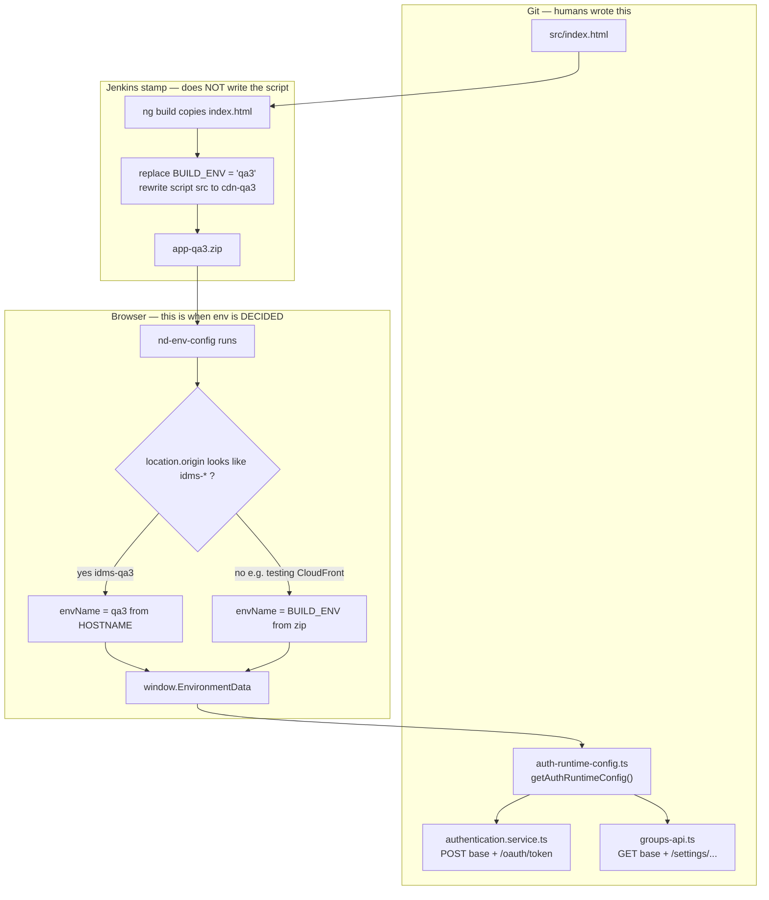

# How we manage environments + APIs (NUX today → MFE)

**Say:** IDMS / NUX dashboard / Netradyne. **Do not say** laptop folder names, Ternary, or the POC repo name.  
**Grounded in:** NUX `index.html` (`#nd-env-config`), `auth-runtime-config.ts`, `AuthenticationService`, feature `*Api` services, `tenant-api-url-builder.ts`, `OAuthInterceptor` URL checks.  
**MFE:** Native Federation **host + kernel + remotes** POC — **mock auth today**; production wiring is host stamp + DI (below).  
**Related:** **one-picture CI/CD:** [ONETRUST_CICD.md](./ONETRUST_CICD.md) · [ONETRUST_AUTH_FLOW.md](./ONETRUST_AUTH_FLOW.md) · [ONETRUST_BUILD_DEPLOY_ENVS.md](./ONETRUST_BUILD_DEPLOY_ENVS.md) · [ONETRUST_ANGULAR_DI_PROVIDERS.md](./ONETRUST_ANGULAR_DI_PROVIDERS.md)

---

## 0. Memorize — if she asks “how do you manage environment / which API / where are APIs?”

### ~45s (today — monolith NUX)

> We **don’t** use Angular `fileReplacements` / a different `environment.prod.ts` per QA. We **build the JS once** and decide the backend **in the browser**.  
>  
> `index.html` has a script **before** Angular. Env name: on a known IDMS host the **origin wins**. Else Jenkins stamps `BUILD_ENV`, else `localStorage['nd::environment']`, else `development` (relative URLs through the local proxy).  
>  
> From the name it builds **origins**: prod has no suffix; `qa3` → `https://auth-qa3.netradyne.com`, `https://idms-qa3.netradyne.com`, `https://api-qa3.netradyne.com`, CDN `cdn-qa3`. **Paths stay the same** (`/authserver/api/v1`, `/restserver/api/v1`, …). That object is `window.EnvironmentData`.  
>  
> Feature code does **not** hardcode `https://api-qa3…`. It concatenates **origin + path prefix** from `getAuthRuntimeConfig()` plus a **resource path** in a `*Api` service (or the URL builder). Auth login is `authServerApiPathAbsolute + '/oauth/token'`. localStorage keys are prefixed `qa3::` so QA tabs don’t collide with prod.

### ~20s extra if she asks MFE

> Same stamp. Host runs that script, then **provides** absolute auth/REST bases as `InjectionToken`s. Remotes `inject` those tokens and keep **resource paths** in the remote’s own `*Api`. Federation **manifest** is where **JS** lives (`remoteEntry.json`), not the REST host. Conversion POC today uses a **kernel mock login** (sessionStorage) to prove one auth owner — we have **not** copied `EnvironmentData` into remotes yet.

---

## 1. Three layers — “where are the APIs?”

If she asks **where we put APIs**, answer in three layers. Mixing them is how people get lost.

| Layer | What lives here | Who owns it |
|---|---|---|
| **A. Farm / origin** | `https://auth-qa3.netradyne.com`, `https://idms-qa3.netradyne.com`, empty for local | `index.html` `#nd-env-config` → `EnvironmentData.EnvironmentConfig` |
| **B. Gateway path prefix** | `/authserver/api/v1`, `/restserver/api/v1`, `/consoleapis/v1`, `/device-health/api/v1`, … | Same `EnvironmentConfig` fields (`*_API_PATH`). Joined in `getAuthRuntimeConfig()` |
| **C. Resource path** | `/oauth/token`, `/session`, `/settings/{tenantId}/subTenantDetails`, `/tenants/{id}/…` | **Auth:** `AuthenticationService` constants. **Product APIs:** `shell/features/**/*-api.ts` (+ `tenant-api-url-builder.ts`) |

**We do not** keep a giant `environment.ts` of hosts. `environments/environment.ts` is basically `{ production, disableFaro }`.

**We do not** put REST hosts in the MFE `federation.manifest.json`. That file is **remote JS URLs only**.

---

## 1b. File-to-file — who writes the script, who stamps, who calls APIs

This is the part that feels magic. **Nobody injects a new `<script>` at deploy.**  
The script is **already in source**. Jenkins only **edits two strings** inside it (and CDN `src=` tags).

### The files (in order)

```text
1. dashboard/src/index.html
      YOU (git) wrote <script id="nd-env-config">
      inside it:  var BUILD_ENV = '';     ← empty in git on purpose
                  detectFromOrigin()
                  resolveUrls(envName)
                  window.EnvironmentData = { … }

2. ng build  (Jenkins ci-build-all / custom-builder)
      copies that HTML into dist/.../browser/index.html
      Angular does NOT delete the script. It is not a component.

3. ci-build-all.js  patchIndexHtml()
   OR custom-builder.js  injectBuildEnv()
      string replace ONLY:
        var BUILD_ENV = '';   →   var BUILD_ENV = 'qa3';
        BUILD_TIME / commit
        <script src="main-AB12.js">  →  <script src="https://cdn-qa3.netradyne.com/app/main-AB12.js">
      zip → app-qa3.zip

4. Browser opens https://idms-qa3.netradyne.com/app/
      HTML parser runs nd-env-config BEFORE <app-root> / Angular
      sets window.EnvironmentData

5. dashboard/src/app/authentication/auth-runtime-config.ts
      getAuthRuntimeConfig()
      reads window.EnvironmentData.EnvironmentConfig
      joins origin + path:
        AUTH + /authserver/api/v1  →  https://auth-qa3.netradyne.com/authserver/api/v1
        IDMS + /restserver/api/v1  →  https://idms-qa3.netradyne.com/restserver/api/v1

6. Feature code concatenates a RESOURCE path
      AuthenticationService  TOKEN_ENDPOINT = '/oauth/token'
      GroupsApi              baseUrl + '/settings/' + tenant + '/subTenantDetails'
```



---

### Snapshot A — source HTML (what lives in git)

File: `dashboard/src/index.html`  
**Author: frontend engineers.** Checked in. Same file for every QA.

```html
<script id="nd-env-config">
(function () {
  var BUILD_ENV = '';          <!-- empty until Jenkins -->
  var ORIGIN_MAP = {
    'https://idms.netradyne.com': 'production',
    'https://idms-staging.netradyne.com': 'staging',
    'https://dashboard-testing.netradyne.info': 'staging'
  };

  function detectFromOrigin(origin) {
    if (ORIGIN_MAP[origin]) return ORIGIN_MAP[origin];
    // idms-qa3.netradyne.com → captures "qa3"
    var m = origin.match(/https?:\/\/(?:idms|auth|dashboard|app|console)-(\w[\w\d]*)\.netradyne\.\w+/);
    return m ? m[1] : '';
  }

  var originEnv = detectFromOrigin(window.location.origin);
  if (originEnv) {
    envName = originEnv;           // REAL IDMS HOST — zip cannot override
  } else {
    envName = localStorage['nd::environment'] || BUILD_ENV || 'development';
  }

  function resolveUrls(env) {
    if (env === 'development') return { idms:'', auth:'', api:'', cdn:'' };
    var s = (env === 'production') ? '' : '-' + env;
    return {
      idms: 'https://idms' + s + '.netradyne.com',
      auth: 'https://auth' + s + '.netradyne.com',
      api:  'https://api'  + s + '.netradyne.com',
      cdn:  'https://cdn-' + env + '.netradyne.com'
    };
  }

  window.EnvironmentData = { EnvironmentConfig: {
    AUTH_SERVER_ORIGIN: urls.auth,
    AUTH_SERVER_API_PATH: '/authserver/api/v1',
    REST_SERVER_ORIGIN: urls.idms,          // IDMS host, not api-*
    REST_SERVER_API_PATH: '/restserver/api/v1',
    /* … */
  }};
})();
</script>
<app-root></app-root>
```

`custom-builder.js` comment at top of file: *“URL resolution is handled at runtime by nd-env-config. We only set BUILD_ENV.”*

---

### Snapshot B — what Jenkins actually changes (the zip)

File: `dashboard/ci-build-all.js` → `patchIndexHtml()`  
Same logic: `dashboard/custom-builder.js` → `injectBuildEnv()`

It does **search-and-replace**, not generate a new script:

```javascript
html.replace("var BUILD_ENV = '';", "var BUILD_ENV = 'qa3';");
rewriteIndexHtmlAssetsToCdn(html, 'qa3');
// script/link tags: main-AB12.js → https://cdn-qa3.netradyne.com/app/main-AB12.js
```

After stamp, **inside `app-qa3.zip` / index.html**:

```html
<script id="nd-env-config">
  var BUILD_ENV = 'qa3';     <!-- THIS is the only env string Jenkins wrote -->
  …
</script>
<script src="https://cdn-qa3.netradyne.com/app/main-AB12.js"></script>
```

Prod zip from the **same** `ng build`:

```html
  var BUILD_ENV = 'production';
<script src="https://cdn-production.netradyne.com/app/main-AB12.js"></script>
```

**Same `main-AB12.js` bytes.** Different **HTML wrapper**.

---

### Snapshot C — browser decides env, then Angular reads it

**Use case 1 — live QA farm (the normal one)**

```text
URL bar:  https://idms-qa3.netradyne.com/app/

nd-env-config:
  origin = https://idms-qa3.netradyne.com
  detectFromOrigin → regex → "qa3"
  envSource = 'origin'
  BUILD_ENV in the zip is IGNORED   ← she will ask this

  resolveUrls('qa3'):
    auth = https://auth-qa3.netradyne.com
    idms = https://idms-qa3.netradyne.com
    cdn  = https://cdn-qa3.netradyne.com

DevTools console:
  [nd-env-config] qa3 (via origin)
    restserver: https://idms-qa3.netradyne.com/restserver/api/v1
    authserver: https://auth-qa3.netradyne.com/authserver/api/v1
```

**Use case 2 — why BUILD_ENV / per-env zip still matters**

Page is **not** `idms-*`. Example: `https://dashboard-testing.netradyne.info/dashboard/` (testing S3/CloudFront).

```text
detectFromOrigin → ORIGIN_MAP says 'staging' for that exact host
  OR if host is unknown → BUILD_ENV from the zip ('qa9') or localStorage
```

**Use case 3 — the zip’s CDN tags (this is why we cannot ship one zip everywhere)**

Even when origin wins for **API** hosts, `index.html` still has:

```html
<script src="https://cdn-qa3.netradyne.com/app/main-AB12.js">
```

If you unpacked **`app-production.zip` onto qa3**, APIs might still go to qa3 (origin wins) but the **JS would load from cdn-production**. Wrong cache, mixed files, CORS. That is the #1 reason for `app-qa3.zip` vs `app-production.zip`.

---

### Snapshot D — Angular turns EnvironmentData into a URL (file)

`dashboard/src/app/authentication/auth-runtime-config.ts`

```typescript
window.EnvironmentData?.EnvironmentConfig
// AUTH_SERVER_ORIGIN: 'https://auth-qa3.netradyne.com'
// AUTH_SERVER_API_PATH: '/authserver/api/v1'

toAbsolutePath(origin, path)
// → 'https://auth-qa3.netradyne.com/authserver/api/v1'

getAuthRuntimeConfig().authServerApiPathAbsolute
getAuthRuntimeConfig().restServerApiPathAbsolute
```

`environments/environment.ts` is **not** in this path (only `production` / `disableFaro`).

---

### Snapshot E — login API (file)

`dashboard/src/app/authentication/services/authentication.service.ts`

```typescript
const TOKEN_ENDPOINT = '/oauth/token';           // resource path — same every env
private readonly runtimeConfig = getAuthRuntimeConfig();
private readonly authServerBaseUrl = this.runtimeConfig.authServerApiPathAbsolute;

// real call:
this.http.post(this.authServerBaseUrl + TOKEN_ENDPOINT, body)
// https://auth-qa3.netradyne.com/authserver/api/v1/oauth/token
```

Groups:

`dashboard/src/app/shell/features/groups/groups-api.ts`

```typescript
private readonly baseUrl = getAuthRuntimeConfig().restServerApiPathAbsolute;
// GET baseUrl + '/settings/' + tenantId + '/subTenantDetails'
// https://idms-qa3.netradyne.com/restserver/api/v1/settings/{id}/subTenantDetails
```

Interceptor (`OAuthInterceptor` + `auth-url.utils.ts`) matches those **absolute prefixes** to add `Authorization` + `session-key`. It does not pick the env.

---

### One picture: zip vs hostname (say this if she asks “then why zips?”)

```text
                    What the ZIP decides                 What the HOSTNAME decides
                    --------------------                 -------------------------
On idms-qa3:        which CDN the JS is loaded from      which AUTH + REST hosts
                    BUILD_ENV (ignored if origin matches)

On testing CF:      BUILD_ENV / ORIGIN_MAP               may not look like idms-qaN
                    → which APIs to call

Saving:             ng build once
                    stamp HTML (seconds)
                    deploy qa3 without compiling
                    cannot point qa3 HTML at prod CDN
```

**Spoken ~35s:** “The env script is in source `index.html` — we wrote it. Jenkins does not add a script; it only fills `BUILD_ENV` and rewrites script tags to that env’s CDN. That’s why each env is a zip: qa3 HTML must load `cdn-qa3`, not `cdn-production`. When the user is on `idms-qa3`, the same script reads the hostname and origin **wins** — APIs go to auth-qa3 and idms-qa3. Angular `getAuthRuntimeConfig()` just concatenates that origin with `/authserver/api/v1`. Feature services only add `/oauth/token` or `/settings/…`. We do not have `environment.qa3.ts`.”

---

```
Browser loads index.html
        │
        ▼
<script id="nd-env-config">          ← BEFORE Angular
  env name: origin > BUILD_ENV / localStorage > development
  resolveUrls(env)                   ← idms / auth / api / cdn
  window.EnvironmentData.EnvironmentConfig
        AUTH_SERVER_ORIGIN + AUTH_SERVER_API_PATH
        REST_SERVER_ORIGIN  + REST_SERVER_API_PATH   ← origin is IDMS, not api-*
        CONSOLE_APIS_*, DEVICE_HEALTH_*, DRIVERI_ONE_* (api-* for Driveri One)
        │
        ▼
main.ts → bootstrapApplication(App, appConfig)
        │
        ▼
getAuthRuntimeConfig()               ← merge defaults + EnvironmentData
  toAbsolutePath(origin, path)
  → authServerApiPathAbsolute
  → restServerApiPathAbsolute
  → consoleApisApiPathAbsolute
        │
        ├─ AuthenticationService
        │    POST {authServerApiPathAbsolute}/oauth/token
        │    POST {authServerApiPathAbsolute}/session
        │
        ├─ GroupsApi / SafetyDashboardApi / …
        │    GET  {restServerApiPathAbsolute}/settings/{tenant}/subTenantDetails
        │    or createRestApiUrlFactory(restServerApiPathAbsolute).…
        │
        └─ OAuthInterceptor
             shouldAddAuthHeadersToURL() matches those absolute prefixes
             adds bearer + session-key + tenant headers
```

**Not this:** `ng build --configuration=qa3` swapping `environment.qa3.ts` into the bundle for every QA.

**Nuance she may probe:** `REST_SERVER_ORIGIN` is **`urls.idms`**, not `urls.api`. Most dashboard REST (`/restserver/...`) goes to the **IDMS** host. **Driveri One** uses `urls.api` (`DRIVERI_ONE_SERVER_ORIGIN`). Auth always uses `urls.auth`.

---

## 3. How we pick the environment (actual `index.html`)

On a **real IDMS / dashboard host**, origin **always wins**. `BUILD_ENV` and localStorage cannot override prod if you opened `idms.netradyne.com`.

| Priority | When | Example |
|---|---|---|
| **1. Origin** | Hostname matches map or `idms\|auth\|dashboard\|app\|console-(\w)` | `https://idms-qa3.netradyne.com` → `qa3` |
| **2. `BUILD_ENV`** | CloudFront / S3 / non-IDMS origin | Jenkins writes `var BUILD_ENV = 'staging'` into the HTML |
| **3. `localStorage['nd::environment']`** | Same, debug | `localStorage.setItem('nd::environment', 'qa9'); location.reload()` |
| **4. `development`** | Local `ng serve` | Empty origins → relative `/authserver/...` → node proxy |

Local: `8080` is treated as **staging** inside `buildEnvironmentConfig()` (Mixpanel / naming), while origins can still be relative via the proxy.

---

## 4. Code snapshot — stamp + origins (`index.html`)

Do **not** recite Mixpanel/Firebase keys in the interview. Structure only:

```javascript
// index.html  — runs before Angular
var BUILD_ENV = ''; // Jenkins patches this in the zip, e.g. 'qa3'

var ORIGIN_MAP = {
  'https://idms.netradyne.com': 'production',
  'https://idms-staging.netradyne.com': 'staging',
  // …
};

function detectFromOrigin(origin) {
  if (ORIGIN_MAP[origin]) return ORIGIN_MAP[origin];
  var m = origin.match(/https?:\/\/(?:idms|auth|dashboard|app|console)-(\w[\w\d]*)\.netradyne\.\w+/);
  return m ? m[1] : '';
}

var originEnv = detectFromOrigin(window.location.origin);
if (originEnv) {
  envName = originEnv;           // origin wins
} else {
  envName = localStorage.getItem('nd::environment') || BUILD_ENV || 'development';
}

function resolveUrls(env) {
  if (env === 'development' || env === 'sandbox') {
    return { idms: '', auth: '', api: '', cdn: '' };  // relative → proxy
  }
  var s = (env === 'production') ? '' : '-' + env;
  return {
    idms: 'https://idms' + s + '.netradyne.com',
    auth: 'https://auth' + s + '.netradyne.com',
    api:  'https://api'  + s + '.netradyne.com',
    cdn:  'https://cdn-' + env + '.netradyne.com'
  };
}

window.EnvironmentData = {
  EnvironmentConfig: {
    ENVIRONMENT_NAME: envName,
    STORAGE_KEY_PREFIX: isLocal ? '' : envName,
    AUTH_SERVER_ORIGIN: urls.auth,
    AUTH_SERVER_API_PATH: '/authserver/api/v1',
    REST_SERVER_ORIGIN: urls.idms,              // IDMS host, not api-*
    REST_SERVER_API_PATH: '/restserver/api/v1',
    REST_SERVER_BETA_API_PATH: '/restserver/api/v2',
    CONSOLE_APIS_SERVER_ORIGIN: urls.idms,
    CONSOLE_APIS_API_PATH: '/consoleapis/v1',
    DRIVERI_ONE_SERVER_ORIGIN: urls.api || urls.idms,
    DRIVERI_ONE_API_PATH: '/driverione/v1',
    DEVICE_HEALTH_SERVER_ORIGIN: urls.idms,
    DEVICE_HEALTH_API_PATH: '/device-health/api/v1',
    // … VLS, DLCM, i18n path, feature flags …
  },
  CDN_URL_ORIGIN: urls.cdn
};
```

**qa3 example after join:**

| Config | Result |
|---|---|
| Auth | `https://auth-qa3.netradyne.com/authserver/api/v1` |
| REST v1 | `https://idms-qa3.netradyne.com/restserver/api/v1` |
| Driveri One | `https://api-qa3.netradyne.com/driverione/v1` |
| Local dev | `/authserver/api/v1` (empty origin) |

---

## 5. Code snapshot — how Angular **picks it up** (`getAuthRuntimeConfig`)

```typescript
// auth-runtime-config.ts  (simplified)

const toAbsolutePath = (origin: string, path: string): string => {
  if (path.startsWith('http://') || path.startsWith('https://')) return path;
  const normalizedOrigin = origin.replace(/\/+$/, '');
  const normalizedPath = path.startsWith('/') ? path : `/${path}`;
  return `${normalizedOrigin}${normalizedPath}`;  // '' + '/authserver/…' → relative
};

const buildEnvironmentConfig = (): RuntimeEnvironmentConfig => {
  const defaults = {
    ENVIRONMENT_NAME: 'development',
    AUTH_SERVER_ORIGIN: window.location.origin,
    AUTH_SERVER_API_PATH: '/authserver/api/v1',
    REST_SERVER_ORIGIN: window.location.origin,
    REST_SERVER_API_PATH: '/restserver/api/v1',
    // … same path keys as index.html …
  };

  const merged = {
    ...defaults,
    ...(window.EnvironmentData?.EnvironmentConfig ?? {}),
  };

  if (location.port === '8080') {
    merged.ENVIRONMENT_NAME = 'staging';
  }
  return merged;
};

export const getAuthRuntimeConfig = (): AppAuthRuntimeConfig => {
  const environment = buildEnvironmentConfig();
  return {
    environmentName: environment.ENVIRONMENT_NAME,
    clientId: 'idms',
    authServerApiPathAbsolute: toAbsolutePath(
      environment.AUTH_SERVER_ORIGIN,
      environment.AUTH_SERVER_API_PATH,
    ),
    restServerApiPathAbsolute: toAbsolutePath(
      environment.REST_SERVER_ORIGIN,
      environment.REST_SERVER_API_PATH,
    ),
    restServerBetaApiPathAbsolute: toAbsolutePath(
      environment.REST_SERVER_ORIGIN,
      environment.REST_SERVER_BETA_API_PATH,
    ),
    consoleApisApiPathAbsolute: toAbsolutePath(
      environment.CONSOLE_APIS_SERVER_ORIGIN,
      environment.CONSOLE_APIS_API_PATH,
    ),
    // deviceHealth, driveriOne, vls, dlcm, i18n, …
  };
};
```

`app.config.ts` **does not** list qa3 URLs. It registers router, `HttpClient`, `OAuthInterceptor`, `APP_INITIALIZER`s. Firebase is gated on runtime config + secure origin. URLs are **read** via this helper.

---

## 6. How **auth** uses those URLs

Auth is still layer C: **fixed suffixes** on the **auth** absolute base.

```typescript
// authentication.service.ts  (simplified)
const TOKEN_ENDPOINT = '/oauth/token';
const SESSION_ENDPOINT = '/session';

private readonly runtimeConfig = getAuthRuntimeConfig();
private readonly authServerBaseUrl = this.runtimeConfig.authServerApiPathAbsolute;

getAccessToken(data: AccessTokenFetchParams, reason: string): Observable<IToken> {
  const params = new URLSearchParams();
  params.set('client_id', data.client_id);
  params.set('grant_type', data.grant_type);
  // password → username/password; else refresh_token

  const endpoint = `${this.authServerBaseUrl}${TOKEN_ENDPOINT}`;
  // qa3: https://auth-qa3.netradyne.com/authserver/api/v1/oauth/token
  // local: /authserver/api/v1/oauth/token

  return this.httpClient.post<IToken>(endpoint, params.toString(), {
    headers: new HttpHeaders({
      'Content-Type': 'application/x-www-form-urlencoded',
      Authorization: this.basicAuthHeader, // Basic base64(client_id:)
    }),
  });
}
```

Session is the same base + `/session`. SSO status is `/auth/sso/status` on that base ([ONETRUST_SSO.md](./ONETRUST_SSO.md)). Token/session **storage** is a different story ([ONETRUST_AUTH_FLOW.md](./ONETRUST_AUTH_FLOW.md)) — env only chooses **which farm** those POSTs hit.

**Interceptor** uses the same absolute prefixes to decide “is this our API?”:

```typescript
// auth-url.utils.ts  (simplified)
export const shouldAddAuthHeadersToURL = (url: string): AuthHeaderDecision => {
  const runtimeConfig = getAuthRuntimeConfig();
  const isRestServerApi = pathnameStartsWithAny(url, [
    runtimeConfig.restServerApiPathAbsolute,
    '/restserver/api/v1',
    '/restserver/api/v2',
  ]);
  const isAuthServerApi = pathnameStartsWithAny(url, [
    runtimeConfig.authServerApiPathAbsolute,
    /* … */
  ]);
  // device-health, driverione, consoleapis, dlcm, i18n, S3, …
  return { shouldAddAuthHeaders: /* any of those */, isAuthServerApi, isRestServerApi, … };
};
```

So: **env script → absolute bases → auth concatenates `/oauth/token` → interceptor matches those bases** to attach bearer / `session-key` / tenant headers. 401 refresh hits the **same** auth base again.

---

## 7. Where **product** APIs live (how we “put” them)

Pattern in NUX today:

1. Feature folder: `shell/features/<domain>/<name>-api.ts` (or `*-api.service.ts`).
2. Grab **base** once: `getAuthRuntimeConfig().restServerApiPathAbsolute` (or console / beta / device-health).
3. Either string-concat a resource path, or `createRestApiUrlFactory(base)` from `tenant-api-url-builder.ts` (typed joiners for `/tenants/{id}/…`).

**String concat (Groups):**

```typescript
@Injectable()
export class GroupsApi {
  private readonly http = inject(HttpClient);
  private readonly baseUrl = getAuthRuntimeConfig().restServerApiPathAbsolute;
  private readonly betaBaseUrl = getAuthRuntimeConfig().restServerBetaApiPathAbsolute;

  // GET https://idms-qa3.netradyne.com/restserver/api/v1/settings/{tenantId}/subTenantDetails?…
  const url = `${this.baseUrl}/settings/${tenantId}/subTenantDetails?isDetailed=false`;
  this.http.get<SubTenantDetailsResponseApiRaw>(url);
}
```

**URL factory (Safety dashboard):**

```typescript
private readonly runtimeConfig = getAuthRuntimeConfig();
private readonly restApiUrls = createRestApiUrlFactory(
  this.runtimeConfig.restServerApiPathAbsolute,
);
private readonly consoleApiUrls = createConsoleApiUrlFactory(
  this.runtimeConfig.consoleApisApiPathAbsolute,
);

// RestApiUrlFactory(base) → joinUrl(base, 'tenants', tenantId, '…')
```

```typescript
export class RestApiUrlFactory {
  constructor(private readonly baseUrl: string) {}
  getSafetyActionCentre(tenantId: TenantIdLike): SafetyActionCentreUrlBuilder { /* … */ }
  getEventVideoLimit(tenantId: TenantIdLike): string {
    return joinUrl(this.baseUrl, 'tenants', tenantId, 'eventVideoLimit');
  }
}
export const createRestApiUrlFactory = (baseUrl: string) => new RestApiUrlFactory(baseUrl);
```

**Spoken:** “Hosts and `/restserver/api/v1` live in runtime config. The **endpoint catalog** lives next to the feature — `*Api` + the shared URL builder — not in `environment.ts`.”

---

## 8. Build / Jenkins (one compile, many farms)

`ci-build-all.js` / `custom-builder.js`: **one** `ng build`, patch `BUILD_ENV` in HTML, CDN rewrite, zip `app-<env>.zip` → artifacts bucket. Details: [ONETRUST_BUILD_DEPLOY_ENVS.md](./ONETRUST_BUILD_DEPLOY_ENVS.md).

---

## 9. MFE — what the POC **actually** does vs what we **will** do

### 9a. Honest: conversion POC is not hitting IDMS REST yet

Host `index.html` is a **plain** Angular index (no `nd-env-config`). Kernel `AuthService` is a **fake** login (`qa@…` / `poc`) into **sessionStorage**. Host `app.config` only `provideKernel()` (Auth + tenant + kernel store). Remotes `inject(KernelStore)` / `inject(AuthService)` to share **session + UI state**, not API origins.

```typescript
// host app.config.ts
export const appConfig: ApplicationConfig = {
  providers: [
    provideRouter(routes, withHashLocation(), …),
    provideKernel(),
  ],
};

// kernel
export function provideKernel(): EnvironmentProviders {
  return makeEnvironmentProviders([AuthService, TenantStore, KernelStore]);
}

// kernel AuthService — POC only
login(email: string, password: string): boolean {
  if (email !== POC_LOGIN_EMAIL || password !== POC_LOGIN_PASSWORD) return false;
  this.userSignal.set(POC_USER);
  sessionStorage.setItem(SESSION_KEY, JSON.stringify(POC_USER));
  return true;
}

// devices remote — shared kernel, hardcoded table (no HttpClient to restserver)
export class DeviceList {
  readonly devices = DEVICES; // ND-1001, …
  readonly kernel = inject(KernelStore);
}
```

**Manifest = JS location, not REST:**

```json
{
  "devices": "http://localhost:5301/remoteEntry.json",
  "safety": "http://localhost:5302/remoteEntry.json",
  "fleet": "http://localhost:5304/remoteEntry.json"
}
```

On a QA CDN this would be `https://cdn-qa3.netradyne.com/…/remoteEntry.json`. Still **not** `https://idms-qa3…/restserver`.

**Why the POC is this way:** prove **one kernel auth owner**, shared DI across remotes, independent remote **assets**. Real OAuth + `EnvironmentData` stay on the **dashboard** until we peel a domain.

### 9b. How we **will** manage APIs in MFEs (same three layers)

When a remote must call restserver:

| Layer | MFE rule |
|---|---|
| **A+B farm + prefix** | **Host** keeps `#nd-env-config` (same script as NUX). Host `useFactory` → `getAuthRuntimeConfig()`. **Provide** tokens. Remotes **never** import `window.EnvironmentData` or host `environment.ts`. |
| **C resource paths** | Stay in the **remote’s** `devices-api.ts` / URL builder — same as today’s feature `*Api`. |
| **Auth** | Kernel owns `AuthenticationService` + interceptor (real ones, not the POC mock). Remotes only `inject(HttpClient)` — interceptors already on the shared runtime. |
| **Manifest** | Which remote **bundle** this env’s CDN serves. |

**Host (target — not in POC yet):**

```typescript
export const AUTH_API_BASE = new InjectionToken<string>('AUTH_API_BASE');
export const REST_API_BASE = new InjectionToken<string>('REST_API_BASE');

export const appConfig: ApplicationConfig = {
  providers: [
    provideKernel(),
    provideHttpClient(withInterceptors([oauthInterceptor])),
    {
      provide: AUTH_API_BASE,
      useFactory: () => getAuthRuntimeConfig().authServerApiPathAbsolute,
    },
    {
      provide: REST_API_BASE,
      useFactory: () => getAuthRuntimeConfig().restServerApiPathAbsolute,
    },
  ],
};
```

**Remote feature API (target):**

```typescript
@Injectable()
export class DevicesApi {
  private readonly http = inject(HttpClient);
  private readonly restBase = inject(REST_API_BASE);

  list(tenantId: string) {
    return this.http.get(`${this.restBase}/tenants/${tenantId}/devices`);
    // qa3: https://idms-qa3.netradyne.com/restserver/api/v1/tenants/…/devices
  }
}
```

Same `GroupsApi` pattern as §7 — only the **base** comes from `inject(REST_API_BASE)` instead of calling `getAuthRuntimeConfig()` in every remote (avoids remotes depending on `window`).

**Do not say:** each remote has `environment.qa3.ts`.  
**Do say:** one stamp, host provides, remotes inject; promote the same remote SHA; only HTML / manifest / CDN prefix change.

---

## 10. Why not `constants.ts` / `environment.qa3.ts`

> If I bake `API_URL = 'https://idms-qa3…'` in TypeScript, I need a **new Angular build** per QA. We have many QAs. We stamp HTML / detect origin so **one JS** talks to the right farm.

Today the “token” is `window.EnvironmentData` + `getAuthRuntimeConfig()`. MFE next step is real `InjectionToken`s so remotes and tests don’t touch `window`. See DI guide §4.

---

## 11. Drill

**Q: Where are you putting APIs?**  
> Origins + `/restserver/api/v1` in `EnvironmentData`. Resource paths in feature `*Api` / URL builder. Auth suffixes in `AuthenticationService`.

**Q: How do you pick them up?**  
> `getAuthRuntimeConfig()` merges `window.EnvironmentData` and joins origin + path. Services read `restServerApiPathAbsolute` / `authServerApiPathAbsolute`.

**Q: Which environment?**  
> Origin on IDMS hosts; else stamped `BUILD_ENV`; else localStorage; else development + proxy.

**Q: How does auth use that?**  
> `authServerApiPathAbsolute + '/oauth/token'` and `'/session'`. Interceptor matches those prefixes for headers and 401 refresh.

**Q: Why is REST on idms not api?**  
> That’s how the stamp is written: restserver/console/device-health on IDMS origin; Driveri One on `api-*`.

**Q: MFE POC vs prod?**  
> POC: kernel mock auth + hardcoded remote UI to prove shared DI. Prod peel: host stamp + tokens; remotes inject bases; manifest is JS only.

**Q: Does `app.config` have the URLs?**  
> It **reads** them (or will `provide` them). It does not hardcode qa3.

---

## 12. Don’t say

| Don’t | Do |
|---|---|
| We rebuild the app for every QA | One JS, runtime / stamp |
| `fileReplacements` is how we do ten QAs | We stamp HTML |
| APIs live in `environment.ts` | Stamp + `*Api` resource paths |
| Remotes each have env files | Host provides; remotes inject |
| Manifest points at restserver | Manifest = `remoteEntry.json` |
| POC already calls qa3 OAuth | POC is mock kernel login |
| Ternary / POC repo name | IDMS, NUX, testing conversion |
| Paste Mixpanel / Firebase keys | Config comes from EnvironmentData / defaults |
