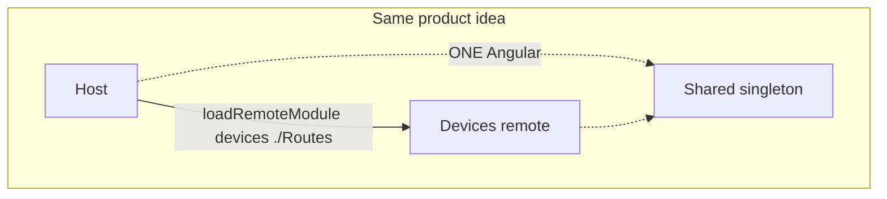
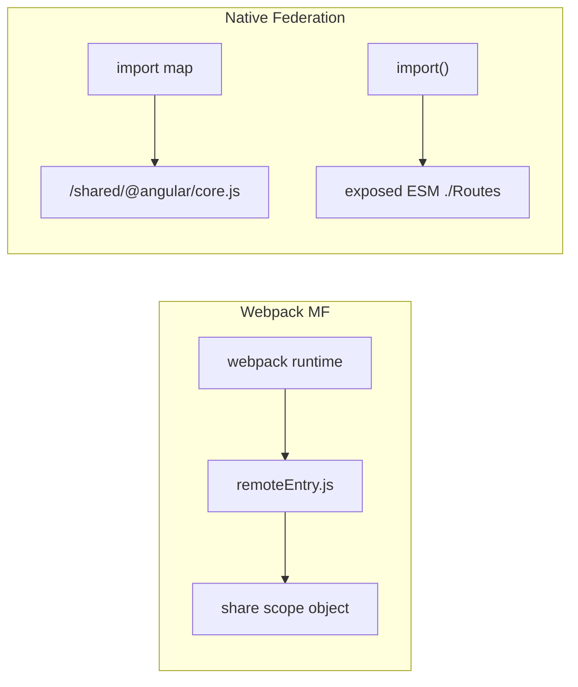

# OneTrust — ESM, import maps, Webpack vs Native Federation

**When she says:** “Native Federation is Module Federation on ESM + import maps — wait, what is ESM? What is an import map? Why Angular?”

**Study this first.** Deep dump: [8 Webpack/ESM](./ONETRUST_WEBPACK_ESM.md) · MFE wording: [4](./ONETRUST_MFE_SENIOR_ROUND.md) §2b · [07 Native vs MF](../micro-frontends/07_NATIVE_VS_MODULE_FEDERATION.md)

---

## 0. 40s opener (the sentence they interrupted)

> **Module Federation** is the **pattern**: host loads remotes at runtime and **shares one Angular**. Webpack 5 invented a famous **implementation** (`ModuleFederationPlugin` + a Webpack **runtime** + `remoteEntry.js`).  
> **Native Federation** is the **same pattern** on **web standards**: remotes are **ES modules**, sharing is an **import map**, so it fits Angular’s **esbuild application builder**. We still say “Module Federation” in a JD. We **don’t** drag Webpack back just to federate.

Three layers — don’t mix:

| Layer | What | Example |
|---|---|---|
| **ESM** | How JS **declares** dependencies | `import { x } from '@angular/core'` |
| **Bundler** | How we **pack** 2000 files → hashed chunks | Webpack **or** esbuild |
| **Federation runtime** | How **two builds** share Angular in one tab | Webpack **share scope** **or** **import map** |

---

## 1. What is ESM?

**ESM = ES Module** = the **official JavaScript module format** (`import` / `export`). Not a bundler. Not Angular.

```ts
// devices.api.ts
export function listDevices() { /* … */ }

// devices.page.ts
import { listDevices } from './devices.api';
```

In the browser:

```html
<script type="module" src="main.js"></script>
```

The browser then **follows** `import`s. That graph is **static** (visible before run) → tree-shake, lazy `import()`.

| | ESM | CommonJS (old Node) |
|---|---|---|
| Syntax | `import` / `export` | `require` / `module.exports` |
| Resolved | **Load time** | **Run time** (can `require` in an `if`) |
| Tree-shake | Natural | Basically no |
| Angular app | **This** | Don’t write this |

**Angular has written ESM for years** — including when `ng build` used Webpack. ESM is **not** “the new Angular instead of Webpack.”

**Spoken ~15s:** “ESM is import/export. The browser and the bundler can see the graph. That’s why we can tree-shake and split lazy routes. Webpack is a tool that *packs* that graph.”

---

## 2. What is Webpack? What does it **do**?

**Webpack is a bundler** (build-time). It:

1. Starts at `main.ts`
2. Follows `import`s (loaders: TS, CSS, assets)
3. Tree-shakes unused ESM exports
4. Splits lazy `import()` into extra files
5. Minifies, hashes (`main.abc123.js`)
6. Injects a **Webpack runtime** into the page — a small JS program that **loads chunks** and, with MF, holds a **share scope** (“which `@angular/core` is the singleton?”)

```text
  hundreds of .ts
        │  Webpack
        ▼
  main.js  +  chunk-admin.js  +  webpack runtime
        │
        ▼  browser
  runtime fetches chunks, runs your app
```

**Webpack 5 Module Federation** = that **same runtime** also fetches **`remoteEntry.js`** from another deploy and registers shared packages **inside Webpack**, not inside the browser’s module spec.

Angular **old** CLI: `@angular-devkit/build-angular:browser` → Webpack.  
Angular **now**: `@angular/build:application` → **esbuild** (same *job*, faster packer). Ivy still compiles templates. esbuild is **not** Ivy.

---

## 3. What is an **import map**?

Browsers only understand **URLs** in `import`. They do **not** know npm names:

```js
import { Component } from '@angular/core';   // ❌ browser: what URL is @angular/core?
```

An **import map** is a **JSON dictionary in HTML** (or injected) that answers that:

```html
<script type="importmap">
{
  "imports": {
    "@angular/core": "/mfe/shared/@angular/core-19.2.0.js",
    "rxjs": "/mfe/shared/rxjs-7.8.0.js",
    "mfe-safety/Routes": "https://cdn-qa3.netradyne.com/mfe/safety/<sha>/routes.js"
  }
}
</script>
```

Now:

```js
import { Component } from '@angular/core';
// browser looks at the map → loads ONE shared file
```

**That is the singleton.** Host and Safety both `import '@angular/core'` → **same URL** → **one** Angular, **one** injector, **one** login.

```text
  Without map:  each remote might bundle its own Angular  →  two apps, broken session
  With map:     both point at /mfe/shared/@angular/core.js →  one copy
```

Webpack MF did the **same job** with a **private share table** in Webpack’s runtime. Import maps do it with the **browser’s** module loader.

**Spoken ~15s:** “An import map remaps bare names like `@angular/core` to one CDN URL. Host and remotes then share that file. Native Federation generates that map. Webpack MF stored the same idea inside Webpack instead of the browser.”

---

## 4. ESM **build** + import maps vs Webpack (the actual vs)

**Not “ESM vs Webpack.”** Two **pipelines** for the same MFE pattern:

```text
A. Webpack era
   source ESM → Webpack packs → webpack runtime in the page
   remotes: remoteEntry.js + ModuleFederationPlugin share scope

B. Native Federation (what we use on conversion)
   source ESM → esbuild packs ESM chunks
   remotes: remoteEntry.json + import map + import()
   browser’s ESM loader does sharing
```

| | **Webpack + Webpack MF** | **esbuild ESM + import maps (Native Federation)** |
|---|---|---|
| What packs the app | Webpack | **esbuild** (Angular `application` builder) |
| What runs in the tab to load remotes | **Webpack runtime** + `remoteEntry.js` | **ESM** `import()` + **import map** + `remoteEntry.json` |
| How `@angular/core` is one copy | `shared: { singleton: true }` in **Webpack memory** | Map points host + remote at **one ESM URL** |
| Fits default Angular 17+ CLI | Fight: you’d stay on Webpack `browser` builder | **Yes** — that’s why we picked it |
| Build speed | Slower, plugin-heavy | Usually **faster** |
| Host payload | Webpack runtime always there | No full Webpack runtime |
| Vocabulary | host, remote, expose, shared | **Same** |





**Why Angular “uses” this:** Angular CLI **left Webpack** for **esbuild**. Webpack MF **needs** Webpack. Native Federation is how you keep **Module Federation architecture** without putting Webpack back.

---

## 5. Why not skip the bundler and only use import maps?

Bare `import` of 2000 source files in the browser = **waterfall**, no minify, no hash. Production still **bundles** (esbuild). Import maps are for **sharing already-built packages/remotes**, not for replacing `ng build`.

```text
  ng build (esbuild)     →  hashed ESM chunks     (always)
  import map             →  where shared / remotes live at runtime  (MFE)
  federation.manifest    →  name → remoteEntry URL per env
```

Manifest ≠ REST API. Manifest ≠ import map. Manifest = “devices JS is at this CDN.” Import map = “`@angular/core` is this file.”

---

## 6. Say this

**~20s ESM:** “ESM is import/export. Static graph. Browser can load it with type=module. Angular source is ESM whether Webpack or esbuild packs it.”

**~20s import map:** “A JSON map from `@angular/core` to one URL so host and remotes share one Angular. Native Federation writes that map.”

**~25s vs Webpack:** “Webpack is a bundler plus a runtime. Webpack MF shares inside that runtime. We pack with esbuild now, so we federate with ESM and import maps — same host/remote/singleton, no Webpack in the shell.”

---

## 7. Traps

| Myth | Truth |
|---|---|
| Native Federation means we don’t bundle | We **still** `ng build` |
| ESM replaced Webpack | ESM is the **format**; Webpack/esbuild **pack** it |
| Import map is `federation.manifest.json` | Different files |
| Two Angulares if versions differ | **Contract break** — `singleton: true` / same mapped URL |
| JD says Module Federation so we must use Webpack | Pattern vs engine |
