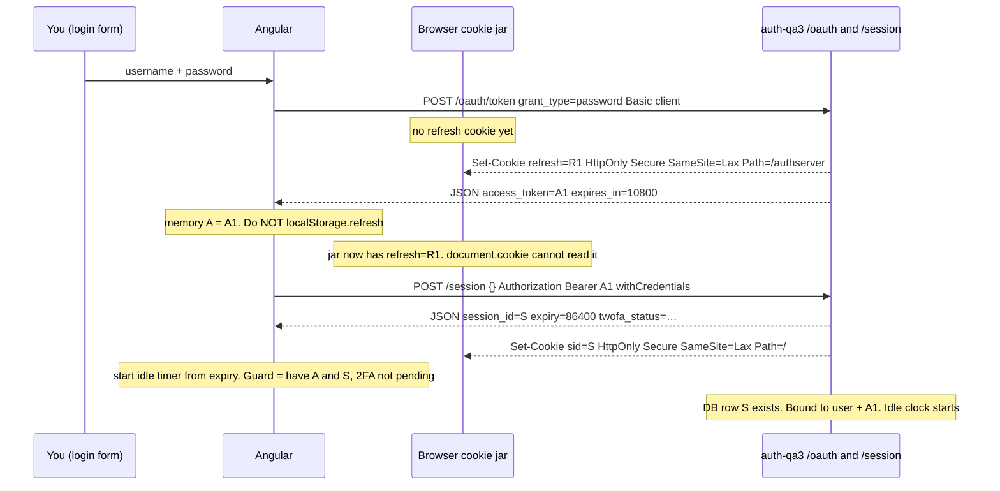
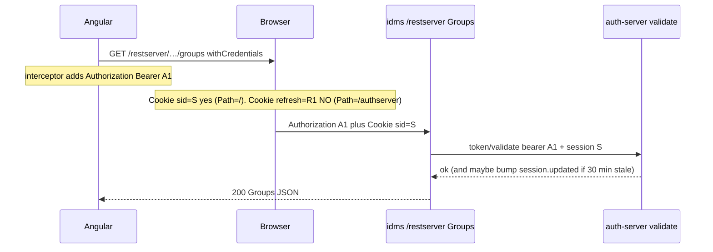
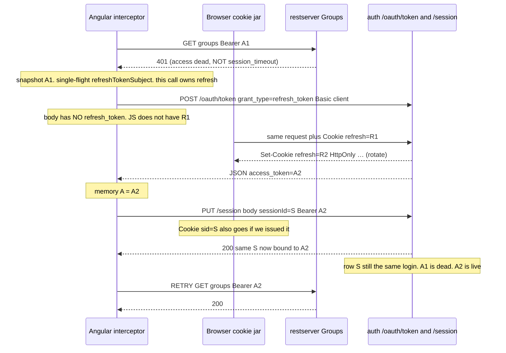
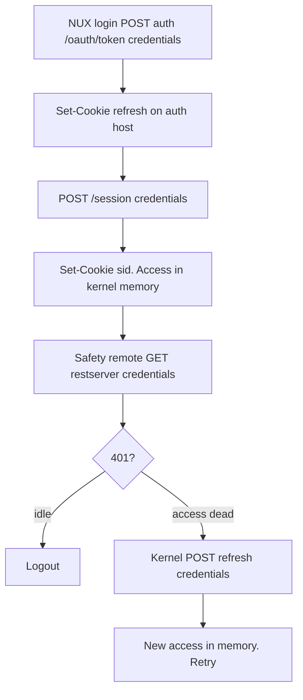

# OneTrust — HttpOnly cookies (how they work + NUX / MFE plan)

**Round 3.** Not in prod today. Today: `localStorage` Bearer + `session-key`.  
MFE POC: kernel **mock** login. This file: **what HttpOnly / Secure / SameSite mean**, XSS vs CSRF, then **how we’d do it on current NUX** and on **MFE kernel**.

**If she asks:** “How will you manage auth in micro-frontends?” → **[ONETRUST_MFE_AUTH.md](./ONETRUST_MFE_AUTH.md)** first.

Related: [ONETRUST_AUTH_FLOW.md](./ONETRUST_AUTH_FLOW.md) · [ONETRUST_OAUTH_JWT_SESSION.md](./ONETRUST_OAUTH_JWT_SESSION.md) · [frontend-system-design/10_FRONTEND_AUTH_SECURITY.md](../frontend-system-design/10_FRONTEND_AUTH_SECURITY.md) · [frontend-system-design/17_CYBERATTACKS_FRONTEND_INTERVIEW.md](../frontend-system-design/17_CYBERATTACKS_FRONTEND_INTERVIEW.md).

---

## 0. 30s opener

> A cookie is a small string the **browser** stores and **attaches** to later HTTP calls to that host. **HttpOnly** means JavaScript cannot read it. **Secure** means HTTPS only. **SameSite** means: do not send this cookie when the request is **cross-site** (evil.com posting to us). Our SPA is on `idms-*.netradyne.com` and auth on `auth-*.netradyne.com` — **different origins, same site**. Cookies still work if we `Set-Cookie` on the **API host** and call with `withCredentials`. We’d put **refresh** (and session) in HttpOnly cookies so XSS cannot steal them; we then fight **CSRF**. Access stays short in **memory**. Same OAuth 2 + session row as today.

---

## 1. What is a cookie? What is HttpOnly?

**Cookie** = name=value the server sends once:

```http
Set-Cookie: refresh=abc123; HttpOnly; Secure; SameSite=Lax; Path=/authserver
```

On the next request to a **matching URL**, the browser adds:

```http
Cookie: refresh=abc123
```

Angular does **not** put that header on. The **browser** does. That is the whole point — and the CSRF risk.

**HttpOnly is a flag, not a different cookie.**  
`document.cookie` / XSS **cannot read** it. DevTools Application tab still shows it (that is the browser, not page JS).

| You might think | Truth |
|---|---|
| HttpOnly = more secure, done | Stops **theft**. Request can still **use** it |
| We send Cookie from the interceptor | No. Browser attaches it. We only set `withCredentials: true` |
| Frontend and backend must be the same URL | Must match **cookie host**. Can be **another subdomain** of the same site |

**Spoken ~15s:** “HttpOnly means JS can’t read the cookie. The browser still sends it on later calls to that host. We use it so XSS can’t copy the refresh token out.”

### Snapshot — where `Set-Cookie` / HttpOnly appear (target login)

**This is not today’s NUX** (today refresh is in JSON + `localStorage`). This is what you’d see in DevTools **Network** after auth-server starts issuing cookies.

Page: `https://idms-qa3.netradyne.com`  
Call: `https://auth-qa3.netradyne.com/authserver/api/v1/oauth/token`

**1) Login request (Angular `HttpClient`, `withCredentials: true`)**

```http
POST /authserver/api/v1/oauth/token HTTP/1.1
Host: auth-qa3.netradyne.com
Origin: https://idms-qa3.netradyne.com
Authorization: Basic aWRtczo=
Content-Type: application/x-www-form-urlencoded

grant_type=password&username=alice&password=***&client_id=idms
```

No `Cookie` yet (first login). No `HttpOnly` on the **request** — that flag only exists on **Set-Cookie**.

**2) Login response — server plants the cookie here**

```http
HTTP/1.1 200 OK
Access-Control-Allow-Origin: https://idms-qa3.netradyne.com
Access-Control-Allow-Credentials: true

Set-Cookie: refresh=R1_opaque_uuid;
            HttpOnly;
            Secure;
            SameSite=Lax;
            Path=/authserver;
            Max-Age=2147483647

Content-Type: application/json

{
  "access_token": "2ec37f53-7d20-47cf-9539-1d0c5f6f8c9b",
  "token_type": "bearer",
  "expires_in": 10800
}
```

| Piece | Who wrote it | Who can read it |
|---|---|---|
| **`Set-Cookie`** | **Auth-server** (Java), not Angular | Browser stores it |
| **`HttpOnly` / `Secure` / `SameSite=Lax`** | Same `Set-Cookie` **attributes** | Not a JSON field. Not something FE sets in TS |
| **`access_token` in body** | Auth-server | Angular — keep in **memory** |
| **`refresh` cookie value** | Auth-server | **Browser only.** `document.cookie` is empty for this name |

DevTools: Network → that POST → **Headers** → Response Headers → `set-cookie`.  
**Application → Cookies → `https://auth-qa3.netradyne.com`** → row `refresh`, checkboxes **HttpOnly** and **Secure**.

**3) Three hours later — refresh (401 path). Browser adds `Cookie`. Angular does not.**

```http
POST /authserver/api/v1/oauth/token HTTP/1.1
Host: auth-qa3.netradyne.com
Origin: https://idms-qa3.netradyne.com
Authorization: Basic aWRtczo=
Cookie: refresh=R1_opaque_uuid

grant_type=refresh_token
```

Interceptor: `withCredentials: true` only. It does **not** `headers['Cookie'] = …`. Chrome copies `refresh` because URL host + Path match.

**4) Auth-server rotates and answers**

```http
HTTP/1.1 200 OK
Set-Cookie: refresh=R2_new_uuid; HttpOnly; Secure; SameSite=Lax; Path=/authserver
{ "access_token": "A2-new-uuid", "expires_in": 10800 }
```

```text
  Angular                          Browser                         Auth-server
     │                                │                                  │
     │  POST /oauth/token             │                                  │
     │  withCredentials               │                                  │
     │───────────────────────────────►│  + Cookie: refresh=R1            │
     │                                │─────────────────────────────────►│
     │                                │  Set-Cookie: refresh=R2 HttpOnly │
     │  body { access_token: A2 }     │◄─────────────────────────────────│
     │◄───────────────────────────────│                                  │
     │  memory = A2                   │  store R2, JS cannot read it     │
```

**Spoken:** “HttpOnly is an attribute on Set-Cookie from the server. Next call, the Cookie request header is added by the browser, not by our interceptor.”

---

## 1b. Full picture — login, session, every API, then refresh

The cookie does **not** replace the session. Same two jobs as today ([AUTH_REVISION](./ONETRUST_AUTH_REVISION.md)):

| Job | What it is | Today (prod) | Target (HttpOnly plan) |
|---|---|---|---|
| **Prove who you are (short)** | Access token **A** | JSON → `localStorage['token']` → header `Authorization` | JSON → **JS memory** → same `Authorization` header |
| **This login / this device (long)** | Session row **S** | `POST /session` → `localStorage['session']` → header `session-key` | **Same `POST /session`**. Then either keep `session-key` from memory, or `Set-Cookie: sid=S` |
| **Mint a new A without password** | Refresh token **R** | Inside `localStorage['token']`. Interceptor puts **R in the POST body** | `Set-Cookie: refresh=R`. Browser puts **R on that one URL**. JS never sees R |

**Wrong picture:** “Browser sets one cookie at login, then every Groups/Safety call sends it, and that *is* the session.”

**Right picture:**

1. **`POST /oauth/token` password** → get **A** (body) + plant **R** (cookie). Session does **not** exist yet.
2. **`POST /session` once** → auth-server **creates** row **S**. That is still a **real HTTP call we write in Angular**, same as today.
3. **Every product API** sends **A** (and **S**). It does **not** call `/session` again. It does **not** send the **refresh** cookie (Path is `/authserver` only).
4. **401 because A is 3h dead** → **then** we hit `/oauth/token` again. **Now** the browser attaches `Cookie: refresh=R`. Then **`PUT /session`** so the **same S** points at the **new A**. Then retry the product API.

### Who sends what (this is the whole trick)

```text
                    Angular interceptor              Browser cookie jar
                    ----------------------           -------------------
Product API         Authorization: Bearer A          Cookie: sid=S
(restserver)        session-key: S  (if no sid cookie)   (if we issued sid cookie)
                    withCredentials: true            NEVER Cookie: refresh=…
                                                     Path=/authserver ≠ /restserver

Refresh API         grant_type=refresh_token         Cookie: refresh=R
(/oauth/token)      Basic client_id                  (HttpOnly — JS cannot copy R)
                    NO refresh in body               MAYBE Cookie: sid if Path matches

POST /session       Authorization: Bearer A          maybe sid after response
(login, once)       body {}
```

Refresh cookie is **not** “on every request.” It is on **matching host + path**. We **want** that: R must **not** ride to Groups.

---

### Diagram A — login (create A, plant R, then create S)



**Session is maintained on the server as that DB row**, not by spamming `/session`.  
`POST /session` = **create**. Later product calls only **validate** S (restserver → auth `token/validate`). `PUT /session` = **after refresh**, bind new A to **same** S.

If we skip the sid cookie and keep today’s header: FE still stores **S in memory** and interceptor still adds `session-key: S`. The **refresh** cookie can exist without the sid cookie. Two independent envelopes.

---

### Diagram B — you click Groups (session already exists)



**No second `POST /session`.**  
**No refresh.** Access A1 is still valid (under 3 hours). Idle row S is still valid (you are using the app).

---

### Diagram C — 3 hours later, access dead, you still sitting there (the refresh flow)

Access **A1** dies at 3h. Session **S** is still alive (idle is 24h). Next Groups call **401** (not `session_timeout`). Same fork as today: **refresh, do not logout.**



That is the **entire** refresh. Three steps, same as prod, only **R** moved from JSON/localStorage to the cookie jar:

| Step | Today | HttpOnly plan |
|---|---|---|
| 1. New access | `POST /oauth/token` body `refresh_token=R1` from `localStorage` | Same URL. Body has **no R**. Browser sends `Cookie: refresh=R1` |
| 2. Bind this login | `PUT /session { sessionId: S }` + bearer **A2** | **Identical.** S still from memory or sid cookie |
| 3. User stays | Retry the Groups call with **A2** | **Identical** |

**PUT 400/401/403** (S gone, often max parallel sessions): **not logout if A2 is good.** Same as today: `POST /session {}` + bearer A2 → new **S2** → maybe `Set-Cookie: sid=S2` → retry. Idle 401 **never** enters this diagram — that is logout, no `/oauth/token`.

```text
  LOGIN                         NORMAL APIs                      ACCESS 401
  -----                         -----------                      ----------
  password ──► A1 in memory     Bearer A1 + sid/S                POST token
               R1 in cookie     refresh cookie STAYS IN JAR      Cookie: R1 ──► A2 in memory
  POST /session ──► S created   validate S on server             R2 Set-Cookie
                                                                 PUT /session S + A2
                                                                 retry Groups
```

**Spoken ~40s:** “Login is still two calls. Token gives access in memory and plants an HttpOnly refresh cookie. Session POST still creates the server row — cookies don’t skip that. Product APIs send the access header; they do not send the refresh cookie because Path is authserver only. When access dies at three hours we POST refresh with credentials, the browser attaches the cookie, we get a new access, PUT the same session id, retry. Idle timeout still logs out — we never refresh that.”

---

## 2. Secure, SameSite, Domain, Path

```text
Set-Cookie: refresh=…; HttpOnly; Secure; SameSite=Lax; Path=/authserver; Domain=auth-qa3.netradyne.com
```

| Flag | Meaning |
|---|---|
| **Secure** | Cookie **only on HTTPS**. HTTP page won’t send it. Required in prod. |
| **Path=/authserver** | Only URLs under that path. Refresh should **not** go to `/restserver`. |
| **Domain** | Which hosts. Host-only (omit Domain) = **that exact host**. `Domain=.netradyne.com` = all subdomains. |

### What “SameSite” actually means

**Site** ≠ **origin**.

| Term | Example | Same as `https://idms-qa3.netradyne.com`? |
|---|---|---|
| **Origin** | scheme + host + port | `https://auth-qa3.netradyne.com` → **NO** (different host) |
| **Site** (eTLD+1) | `netradyne.com` | `https://auth-qa3.netradyne.com` → **YES** (same company site) |
| **Cross-site** | `https://evil.com` | **NO** |

**SameSite=Lax** (what we’d use):

- Request **from our SPA to our auth host** (same site, even if cross-origin) → cookie **is sent**.  
- Attacker page `evil.com` does `POST https://auth-qa3…/oauth/token` → cookie **is not sent**.  
- User **clicks a link** from email to IDMS (top-level GET) → Lax **may** send cookies (login still works).  
- **Strict**: even that GET from another site won’t send — can break “open dashboard from email.”  
- **None**: send even cross-site. **Must** have `Secure`. Needed only if UI and API are **different sites** (e.g. `app.com` → `api.io`).

**Spoken ~20s:** “SameSite is not same URL. idms and auth are different origins, same site — Lax cookies still go on our XHR. evil.com is another site — Lax blocks the cookie on their POST. That’s CSRF protection.”

---

## 3. Backend on another domain — will HttpOnly work?

**Depends if it is another origin or another site.**

**Our farms (today):** page `https://idms-qa3.netradyne.com`, token API `https://auth-qa3.netradyne.com`, REST often `https://idms-qa3.netradyne.com/restserver`.

```text
SPA origin:     idms-qa3.netradyne.com
Auth API:       auth-qa3.netradyne.com     ← cookie for refresh lives HERE
REST API:       idms-qa3.netradyne.com     ← sid cookie can live HERE
```

Cookies follow the **request URL**, not “where the JS file was downloaded.”

1. Login `POST https://auth-qa3…/oauth/token` → `Set-Cookie: refresh=…` for **auth-qa3**.  
2. Later refresh: same host → browser sends `refresh`. **Works** even though the tab’s address bar is **idms**.  
3. Extra: CORS. Cross-origin XHR needs:
   - FE: `withCredentials: true`
   - Auth: `Access-Control-Allow-Origin: https://idms-qa3.netradyne.com` (**exact**, not `*`)
   - `Access-Control-Allow-Credentials: true`

**If backend were a totally different site** (`https://api.othercompany.io`):

- Default **Lax** cookie set on `idms-…` **will not** go to `othercompany.io`.  
- Cookie set **on** `api.othercompany.io` **will** go when we call that API (still HttpOnly).  
- That call is **cross-site** from the SPA’s site → need **`SameSite=None; Secure`** or a **BFF** on the **idms** origin so the browser only talks to one site.

**Spoken:** “Different subdomain is fine. Different company domain is painful — BFF or SameSite=None. We are same site, two origins, CORS plus credentials.”

---

## 4. XSS vs CSRF (how they work, which is “better”)

Neither attack is “OK.” We **choose which tax** we pay.

### XSS — Cross-Site Scripting

Attacker injects **JS into our page** (unsafe `innerHTML`, stolen CMS HTML, malicious package).

```text
Today:  stolenScript runs on idms-qa3
        localStorage['token']  →  send refresh to attacker.com
        Attacker logs in as you from home  (theft)

HttpOnly:  stolenScript cannot read refresh cookie
           Can still call our APIs FROM YOUR TAB until you close it
           Cannot copy the secret out as easily
```

### CSRF — Cross-Site Request Forgery

You are logged in. You open **evil.com**. That page fires a request **to our API**. Browser **attaches cookies** for our site. Server thinks **you** clicked.

```text
evil.com:
  <form action="https://idms-qa3.netradyne.com/restserver/…/delete" method="POST">
Bearer + localStorage:  form cannot set Authorization  →  usually fails
Cookie session:         Cookie: sid=… is auto-sent     →  must block (SameSite / CSRF token)
```

| | **Bearer in localStorage (today)** | **HttpOnly cookie (target)** |
|---|---|---|
| XSS **steals** secret | **Yes** — worst | **Hard** (can’t read cookie) |
| XSS **uses** your tab | Yes | Yes (until logout) |
| CSRF from evil.com | **Hard** (no Bearer header) | **Easier** unless SameSite + CSRF token |
| What we optimize | Convenient 3-app share | **Stop refresh theft** |

**Verdict:** For a **refresh token**, HttpOnly is **better**. Access in **memory** (short). CSRF we **design for** (Lax, Path, CSRF header). Saying “CSRF is OK” is wrong; saying “XSS theft of refresh is worse for us today” is the story.

**Spoken ~25s:** “XSS runs in our page and can read localStorage. CSRF is another site riding our cookies. Bearer is CSRF-safer and XSS-worse. HttpOnly is XSS-theft-safer and CSRF-worse. I’d rather protect refresh from theft and add SameSite.”

---

## 5. Implement on **current** NUX (cloud dashboard), not only MFE

Same product: password / SSO → token → session → interceptor → 401 refresh → idle / 2FA.

**Auth-server**

- Login + refresh: `Set-Cookie: refresh=…; HttpOnly; Secure; SameSite=Lax; Path=/authserver`  
- `POST /session`: `Set-Cookie: sid=…; HttpOnly; Secure; SameSite=Lax; Path=/` on **idms** host (or Domain=`.netradyne.com` if REST is that host)  
- Logout: `Max-Age=0`  
- Keep JSON `access_token` in body for a while (memory). **Stop** returning refresh in JSON (or ignore it on FE).  
- CORS credentials for `https://idms-*.netradyne.com`

**Dashboard `AuthenticationService` / interceptor**

- `HttpClient` to auth + REST: `withCredentials: true`  
- **Do not** `localStorage.setItem('token')` with refresh  
- Access: **in-memory** only (reload: silent `POST refresh` with cookie, or `GET /session/me`)  
- 401: `POST /oauth/token` grant refresh **no body token** — cookie goes  
- Same `refreshTokenSubject` single-flight  
- Idle: still `session.expiry` timer; timeout → logout (clear cookies via API)  
- Guard: memory access or session/me; 2FA pending unchanged  
- Permissions: same `/users/user` — AuthZ unchanged  
- `/app` iframe **same site**: cookies attach automatically — we can drop sharing `localStorage['token']` once console is migrated

**Phased so old console doesn’t break:** dual-write (JSON refresh **and** cookie) → NUX cookie-only → console/iframe follow.

---

## 6. Same thing on **MFE**

Page is still **idms host**. Remotes are **JS**, not another login origin.

- **Kernel** `AuthService` + interceptor: the **only** `withCredentials` / refresh owner (`singleton: true`)  
- Remotes `inject` AuthService; **never** touch cookies  
- POC mock `sessionStorage` **deleted** on peel  
- If a remote were hosted as **another site**, cookies would not follow — don’t do that; load `remoteEntry` as script on the **same page**



---

## 7. Interview Qs

**Q: What is HttpOnly?**  
Flag: JS can’t read the cookie. Browser still sends it.

**Q: What is SameSite? Secure?**  
SameSite = don’t send on **cross-site** requests (Lax vs Strict vs None). Secure = HTTPS only. **Site** = `netradyne.com`, not the full hostname.

**Q: Frontend and backend on different domains?**  
**Subdomains of the same site:** yes — cookie on the **API host**, CORS + `withCredentials`. **Other company’s domain:** need SameSite=None or a BFF.

**Q: XSS vs CSRF — which is better to accept?**  
Neither. Today XSS can **steal** refresh. Cookies stop theft, add CSRF — we mitigate CSRF. I’d take HttpOnly refresh.

**Q: How on current NUX?**  
Auth-server Set-Cookie; interceptor credentials; access memory; refresh POST without JS refresh token; keep session row.

**Q: How on MFE?**  
Same cookies; **kernel** owns interceptor; remotes don’t store tokens.

**Spoken ~30s:** “HttpOnly Secure SameSite Lax on the refresh cookie. Our idms and auth hosts are same site, different origin — CORS with credentials. XSS can’t steal refresh; SameSite blocks evil.com CSRF. Access in memory, session still a server row. Monolith interceptor or MFE kernel — same plan.”
