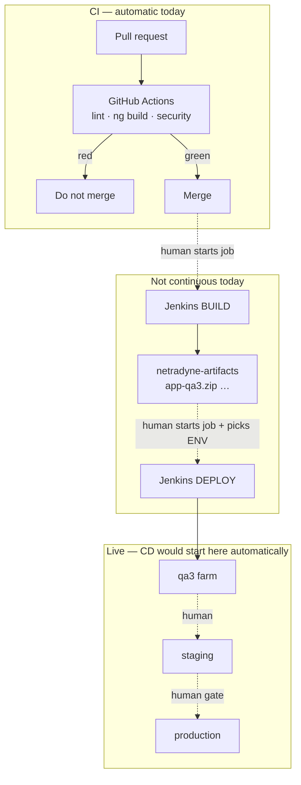
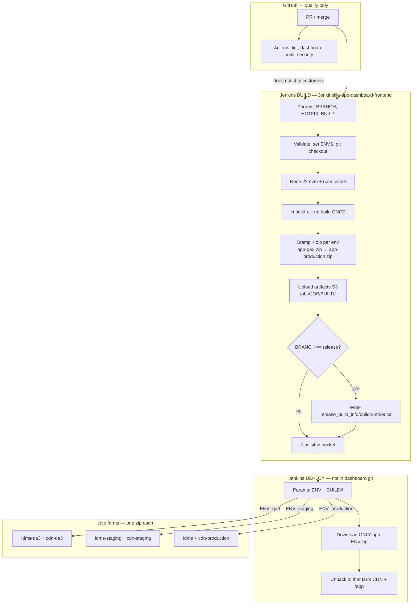
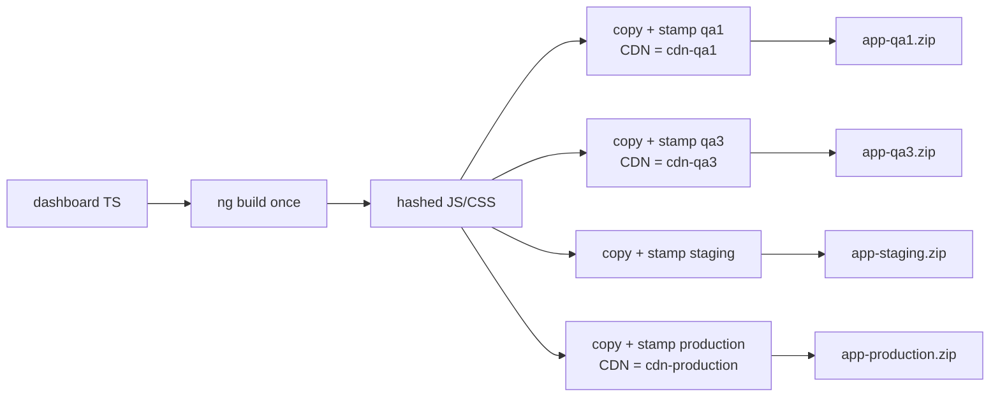
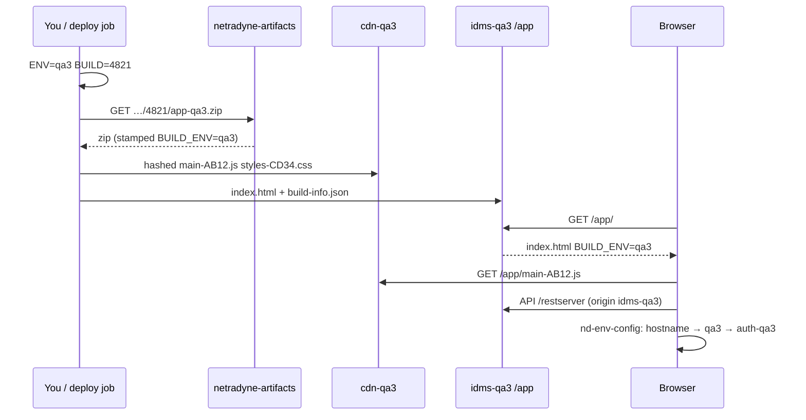

# OneTrust — NUX Jenkins: build job vs deploy job (env diagram)

**Prefer the short card:** [ONETRUST_CICD.md](./ONETRUST_CICD.md). This file is the long dump.

**Round 3.** Draw this if they ask “how does Jenkins deploy QA vs staging vs prod?”

**Grounded in checked-in code** from IDMS NUX (`cloud-front-end`) + sibling `/app` (`cloud-front-end-app`) + backend (`cloud`).  
**Do not say** laptop folder names.

**Related:** short interview card [ONETRUST_BUILD_DEPLOY_ENVS.md](./ONETRUST_BUILD_DEPLOY_ENVS.md) · runtime URLs [ONETRUST_ENVIRONMENT_STORY.md](./ONETRUST_ENVIRONMENT_STORY.md) · [frontend-system-design/18_NETRADYNE_DEVOPS_CI_CD.md](../frontend-system-design/18_NETRADYNE_DEVOPS_CI_CD.md)

---

## 0. What is CI? What is CD? What do *we* have?

People say “CI/CD” as one word. They are **two loops**.

| | **CI — Continuous Integration** | **CD — Continuous Delivery** (what the company guide means) |
|---|---|---|
| Question | “Did this change **break the build / quality**?” | “Can we **ship this same artifact** to an env without rebuilding?” |
| Trigger | **Every PR** (automatic) | **After** a green artifact exists |
| Output | Green/red check on GitHub | App **running** on qa3 / staging / prod |
| Fail means | Do not merge | Do not **promote** |

**Continuous Deployment** (the other “CD”) = merge → **prod with no human**. We do **not** do that. Prod stays a gate.

**Spoken ~15s:** “CI is automatically proving the change is healthy. CD is automatically (or one-click) putting a **built artifact** on an environment. Deploying to prod on every merge is continuous **deployment** — we don’t do that.”

### Company target (Confluence SDLC) vs honest today

```text
TARGET (Continuous Delivery)
  PR → CI → merge main
         → buildArtifact ONCE
         → deployArtifact(QA) + automated tests
         → promote SAME bits → staging
         → human gate → prod
         → rollback = previous artifact

TODAY (NUX dashboard)
  PR → GitHub Actions CI          ✅ automatic
  merge                            ✅
  human clicks Jenkins BUILD       ⚠️  artifact factory (not on every merge)
  human clicks Jenkins DEPLOY env  ⚠️  delivery exists, not continuous
  QA tests by people               ⚠️
  human deploys staging / prod     ⚠️
```

**Verdict to say in the room:**

> **CI is happening.** GitHub Actions on every PR.  
> **CD as “merge automatically lands on QA and promotes itself” is not happening yet.** We still **manually** run a **build job** then a **deploy job**. What we *do* have is the **shape** of CD: **build once, stamp zips, promote a zip** — not rebuild on the farm. The company guide is moving us from this **manual delivery** to **true Continuous Delivery**.

---

### CI in this project — what runs, what it does

Two layers. Do not call Jenkins “the CI” and ignore Actions, or the reverse.

```text
                    CONTINUOUS INTEGRATION (today)
  ┌─────────────────────────────────────────────────────────────────┐
  │  EVERY PR  (automatic — this is the real CI)                    │
  │                                                                 │
  │  GitHub Actions                                                 │
  │    ci-guardrails.yml      changed-files policy + lint           │
  │    build-dashboard.yml    Node 22, npm ci, dashboard ng build   │
  │    security-guardrails    dependency-review + CodeQL            │
  │    release-pr-quality     PRs into `release` must pass build    │
  │                                                                 │
  │  Result: merge blocked if red.  Does NOT write live farms.      │
  │          Does NOT write s3://netradyne-artifacts.               │
  └─────────────────────────────────────────────────────────────────┘
           │ merge / later
           ▼
  ┌─────────────────────────────────────────────────────────────────┐
  │  RELEASE INTEGRATION (Jenkins BUILD — often a human click)      │
  │                                                                 │
  │  Jenkinsfile-app-dashboard-frontend   agent build-fleet         │
  │    BRANCH + HOTFIX_BUILD                                        │
  │    Node 22, npm cache, ci-build-all                             │
  │    app-qa1.zip … app-production.zip                             │
  │    → netradyne-artifacts/jobs/<JOB>/<BUILD>/                    │
  │                                                                 │
  │  This is still “integration”: one compile, all env stamps.      │
  │  It is NOT Continuous Delivery — QA is not updated yet.         │
  └─────────────────────────────────────────────────────────────────┘
```

| CI piece | When | What it proves |
|---|---|---|
| **`ci-guardrails`** | PR open/sync | Repo policy on which files moved; text lint on the diff |
| **`build-dashboard`** / reusable workflow | PR/push `main` | Dashboard actually **compiles** (Node 22, `npm ci`) |
| **`security-guardrails`** | PR | Dependency review + CodeQL |
| **`release-pr-quality`** | PR **into `release`** | Release train cannot take a branch that fails dashboard build |
| **Jenkins BUILD** | Operator picks `BRANCH` | Official **multi-env zips** in the artifact bucket |
| **Local cousin** | Pre-commit | `scripts/ci/run-dashboard-jenkins-build.sh` — same ENVS idea, **no S3** |
| **Sonar** | Separate `cloud` Jenkinsfiles | Java / FE scan jobs — quality, not ship |

**What CI does *not* do here:** unpack onto `idms-qa3`, invalidate CloudFront, run the 13-env stamp on GitHub, or mint `app-qa3.zip` for ops.

**Spoken ~20s:** “Our CI is GitHub Actions on the PR: lint, dashboard build, security. That’s automatic. Jenkins build is the second CI-ish step — it stamps the real env zips into artifacts S3 — but someone still starts that job with a branch.”

---

### CD in this project — is it happening?

**Short answer: delivery yes, continuous no.**

| CD idea | We have it? |
|---|---|
| Immutable artifact (`app-qa3.zip`) | **Yes** — Jenkins BUILD |
| Deploy **without** `ng build` on the farm | **Yes** — deploy job unzips |
| Pick **one env** (`qa3`) without touching prod | **Yes** — env-scoped zip |
| Rollback = previous zip | **Yes** (if you keep old builds in the bucket) |
| Merge → **auto** deploy QA | **No** |
| Auto tests gate the next env | **No** (QA is people; GHA is not env smoke) |
| Promote **same** zip QA → staging → prod | **Almost** — same **compile**, but **different zip** per env because `index.html` / CDN host is stamped. Company target is one digest + runtime config. |
| Auto prod | **No** — and we don’t want that |

```text
  CI green
     │
     │  ← continuity STOPS here today
     ▼
  Human: Jenkins BUILD
     │
     ▼
  zips sitting in netradyne-artifacts     ← releasable, not released
     │
     │  Human: DEPLOY  ENV=qa3  BUILD=4821
     ▼
  idms-qa3 / cdn-qa3 live
     │
     │  Human QA
     │  Human: DEPLOY staging, then production
     ▼
  customers
```

Laptop `s3-sync-deploy.sh` is **not** CD. It is a **preview** sync to a testing bucket. Don’t call it the release train.

**Why the company still says “we need CD”:** today a person must remember to build, then deploy the **right** env zip. A bad day is “tested on QA from a different compile than prod.” True CD = **one artifact**, auto to QA, promote **those bits**.

**Spoken ~25s:** “CD in the textbook sense — merge deploys itself — we don’t have yet. We have a deploy job that promotes a zip to one environment, so delivery is job-based and env-based, not continuous. I’d call it CI plus manual artifact promotion. The SDLC target is to hook deploy+validate onto merge for QA, keep prod as an approval.”



---

## 0b. Build job vs deploy job (the one fact that unlocks the diagram)

There are **two jobs**, not one mega pipeline that compiles Angular on the QA box.

| Job | What it does | Where the Jenkinsfile lives |
|---|---|---|
| **Build** | Checkout branch → **one** `ng build` → **stamp 13 env zips** → upload to **artifact S3** | **In the FE repo:** `Jenkinsfile-app-dashboard-frontend` |
| **Deploy** | Pick **one** env + **one** build number → download **that env’s zip** → unpack onto **that farm’s** CDN / IDMS `/app` | **Not in the dashboard git repo.** Consumes `s3://netradyne-artifacts/jobs/<JOB>/<BUILD>/app-<env>.zip`. Company SDLC name: `deployArtifact(artifact, env)` |

The build job **never** talks to `idms-qa3` or `cdn-qa3`. It only writes zips.  
The deploy job **never** runs `ng build`. It only **promotes a zip that already exists**.

```text
                    BUILD JOB (FE git)                         DEPLOY JOB (ops / infra)
                    ------------------                         ------------------------
  BRANCH + HOTFIX  →  compile once                             ENV=qa3 + BUILD=4821
                      stamp qa1…qa10, staging, demo, prod      download app-qa3.zip
                      upload ALL zips to artifacts S3   ───►   unpack to qa3 CDN + /app
                                                               browser: idms-qa3.netradyne.com
```

**Spoken ~20s:** “Jenkins build compiles once and stamps a zip per environment into the artifacts bucket. Deploy is a second job: you choose qa3 and a build number, it pulls `app-qa3.zip` and puts it on that farm. We do not rebuild Angular on the QA host.”

---

## 1. Whole train (memorize this picture)

```text
  Developer PR
       │
       ▼
  GitHub Actions          lint / quality ng build / CodeQL
  (NOT the release)       PRs to main / release stay green
       │
       │  human triggers Jenkins  (param BRANCH, optional HOTFIX_BUILD)
       ▼
┌──────────────────────── BUILD JOB ─────────────────────────────────────────┐
│  agent: build-fleet                                                         │
│  file:  Jenkinsfile-app-dashboard-frontend                                  │
│                                                                             │
│  1 Validate & Initialize                                                    │
│       ENVS = hotfix ? [staging, production]                                 │
│            : [staging, qa1…qa10, demo, production]                          │
│       git checkout cloud-front-end @ BRANCH                                 │
│                                                                             │
│  2 setBuildName                                                             │
│       display #4821 (release)   or   #4821 (hotfix-branch) (HOTFIX)         │
│                                                                             │
│  3 BuildComponents → buildApp   (only if dashboard/package.json exists)     │
│       nvm Node v22.14.0                                                     │
│       npm cache keyed by package.json md5                                   │
│       node ci-build-all.js --zip-to $WORKSPACE/WebContent  <ENVS>           │
│            │                                                                │
│            ├─ ONE  ng build  →  dist/.../browser  (hashed JS/CSS)           │
│            └─ FOR EACH env: copy → stamp index.html → zip app-<env>.zip     │
│                                                                             │
│  4 Create Build Artifacts                                                   │
│       WebContent/buildinfo.txt  (BUILD, REVISION, PROJECT=app-dashboard-    │
│                                  frontend, BUILD_DATE)                      │
│                                                                             │
│  5 Upload to S3   ← THIS IS STILL BUILD, NOT LIVE                           │
│       aws s3 cp WebContent →                                                │
│         s3://netradyne-artifacts/jobs/<JOB_NAME>/<BUILD_NUMBER>/            │
│       if BRANCH=release → also write                                        │
│         …/release_build_info/buildnumber.txt   (pointer: “use 4821”)        │
└───────────────────────────────────┬─────────────────────────────────────────┘
                                    │
                                    ▼
              s3://netradyne-artifacts/jobs/app-dashboard-frontend/4821/
                    app-qa1.zip  …  app-qa10.zip
                    app-staging.zip  app-demo.zip  app-production.zip
                    buildinfo.txt
                                    │
                                    │  ops / second Jenkins job
                                    │  params: ENV, BUILD (or “latest release”)
                                    ▼
┌──────────────────────── DEPLOY JOB ────────────────────────────────────────┐
│  Does NOT compile.                                                          │
│  aws s3 cp  …/4821/app-qa3.zip  →  tmp                                      │
│  unzip onto the qa3 static origin:                                          │
│       CDN:    https://cdn-qa3.netradyne.com/app/     (hashed JS/CSS)        │
│       App:    https://idms-qa3.netradyne.com/app/    (index.html + SPA)     │
│  index.html is short-cache; hashed chunks are long-cache.                   │
└───────────────────────────────────┬─────────────────────────────────────────┘
                                    ▼
              You open https://idms-qa3.netradyne.com/app/
              nd-env-config: origin → qa3
              JS from cdn-qa3 …/main-XXXX.js
              APIs: auth-qa3 / idms-qa3  (same paths, different hosts)
```



---

## 2. Build job — stages as written in the Jenkinsfile

**Agent:** `build-fleet`  
**Params:**

| Param | Meaning |
|---|---|
| `BRANCH` | Git parameter. Required. Checkout of `netradyne/cloud-front-end` |
| `HOTFIX_BUILD` | `false` = full matrix. `true` = **staging + production only** |
| `GIT_CHECKOUT_TIMEOUT_MINUTES` | Default 25 |

### Stage: Validate & Initialize

```groovy
ENVS = (HOTFIX_BUILD == 'true')
  ? ['staging', 'production']
  : ['staging', 'qa1', 'qa2', 'qa3', 'qa4', 'qa5',
     'qa6', 'qa7', 'qa8', 'qa9', 'qa10', 'demo', 'production']
```

Then `git checkout` that `BRANCH`. Creates `WebContent/` (zip drop folder).

**This list is the environment-based build.** One job, many zips. Not “a Jenkins job per QA.”

### Stage: setBuildName

Jenkins UI title: `#${BUILD_NUMBER} (${BRANCH})` plus `(HOTFIX)` if flagged. Resolves AWS region from CLI or instance metadata (for later `aws s3 cp`).

### Stage: BuildComponents → buildApp

Runs only if `dashboard/package.json` exists. `catchError` so a dashboard failure is **stage FAILURE / build SUCCESS** (legacy pattern — mention only if asked).

Inside `dashboard/`:

1. **nvm `v22.14.0`**
2. **`npmUpdateCache`** — md5 of `package.json` vs `~/.cache/md5/dashboard`. Match → copy cached `node_modules` + `npm install`. Miss → full install, refresh cache.
3. **Preferred:** `node ci-build-all.js --zip-to $WORKSPACE/WebContent qa1 qa2 …`  
   **Fallback** if that script is missing: loop `node custom-builder.js --configuration <env>` (rebuild Angular **per env** — slow, the old way).

### Stage: Create Build Artifacts

Writes `WebContent/buildinfo.txt`:

```text
BUILD=4821
REVISION=<git sha>
PROJECT=app-dashboard-frontend
BUILD_DATE=<date>
```

### Stage: Upload to S3

```text
s3://netradyne-artifacts/jobs/${JOB_NAME}/${BUILD_NUMBER}/
```

| Mode | What goes up |
|---|---|
| Full | `app-*.zip` + `buildinfo.txt` |
| Hotfix | **only** `app-staging.zip` + `app-production.zip` + `buildinfo.txt` |
| `BRANCH == release` | extra pointer `…/release_build_info/buildnumber.txt` containing `4821` |

**Artifact bucket ≠ user-facing CDN.** Users never hit `netradyne-artifacts`. That bucket is the **warehouse**. Deploy copies **out** of it onto `cdn-*` / `idms-*`.

Post: echo success path, `deleteDir()` cleanup.

---

## 3. Inside `ci-build-all.js` — why “env” exists at build time

This is **not** 13 Angular compiles. It is **stamp**.

```text
  [1/3]  npx ng build          →  dist/.../browser/
         hashed bundles: main-AB12.js, styles-CD34.css
         SAME files for every env

  [2/3]  for env in ENVS:
           copy dist → dist/ci/<env>/
           patch index.html:
             BUILD_ENV = 'qa3'
             BUILD_TIME, commit hash/msg
             <script src="https://cdn-qa3.netradyne.com/app/main-AB12.js">
           write build-info.json
           validate EnvironmentData / AUTH_SERVER_ORIGIN / REST_SERVER_ORIGIN
           zip → WebContent/app-qa3.zip
           delete dist/ci/qa3 (disk)

  [3/3]  done
```



What **changes** per zip: `index.html` (`BUILD_ENV`, CDN host on script/link tags), `build-info.json`.  
What **does not** change: the hashed JS/CSS **bytes**. Lazy chunks follow `import.meta.url` of the CDN entry script (`cdn-asset-rewrite.js`).

**APIs are not baked as `environment.qa3.ts`.** Stamp sets `BUILD_ENV`. In the browser, `nd-env-config` still resolves **idms / auth / api / cdn** from hostname (origin wins on a real IDMS host). See file **7**.

### Why S3? Why a **different zip per env**? What does that save?

**S3 here is a warehouse, not the website.**  
`s3://netradyne-artifacts/jobs/<job>/<buildNumber>/` stores **build #4821’s packages**. Users hit `idms-qa3` / `cdn-qa3`. Deploy **copies one zip out**. If Jenkins died tomorrow, those zips still exist to redeploy.

One Jenkins build folder looks like:

```text
s3://netradyne-artifacts/jobs/app-dashboard-frontend/4821/
    app-qa1.zip
    app-qa3.zip          ← only this is what qa3 deploy downloads
    …
    app-staging.zip
    app-production.zip
    buildinfo.txt
```

**Yes: one zip per environment, from the same compile.**  
We are **not** compiling Angular 13 times. We **copy** the same `main-AB12.js` into each zip and **rewrite `index.html`**.

| Inside the zip | Same across qa3 / staging / prod? | Why it must differ |
|---|---|---|
| `main-AB12.js`, `styles-CD34.css`, lazy chunks | **Yes — same bytes** | One `ng build`. That is the expensive part. |
| `index.html` → `BUILD_ENV = 'qa3'` | **No** | Fallback when hostname is not `idms-*` (testing CloudFront, S3 preview). |
| `index.html` script/link tags | **No** | qa3 must load `https://cdn-qa3.netradyne.com/app/main-AB12.js`, not `cdn-production`. One `deployUrl` cannot hold 13 CDN hosts. |
| `build-info.json` | env name + same `buildTime` | Refresh toast / “which build is live.” |

**Why not one zip for every farm?**  
If qa3 unpacked a zip whose `<script src>` pointed at **cdn-production**, the QA page would run **prod CDN JS** (wrong cache, wrong mix of files, CORS/host mismatch). Each farm has its **own CDN host**. The wrapper (`index.html`) has to match **that** host. The JS payload does not.

**What this saves (the whole point):**

| Without per-env stamp | With stamp + many zips |
|---|---|
| `ng build` × 13 (minutes × 13) | `ng build` **once** (minutes). Stamp is **seconds**. |
| Deploy qa3 by compiling on the QA box | Deploy = **download + unzip**. No Node on the farm. |
| Ship qa3 and accidentally rebuild for prod | Prod zip already sitting next to it from the **same** SHA |
| Hotfix waits on 10 QAs | `HOTFIX_BUILD`: only staging+prod zips |
| Rollback = git checkout old + rebuild | Rollback = deploy **previous** `app-qa3.zip` |

**Spoken ~20s:** “We store zips in the artifacts S3 bucket so deploy never compiles. We make one zip per env because index.html must point at that env’s CDN — `cdn-qa3` vs `cdn-production`. The JavaScript hashes are the same compile. That’s what we save: one ng build, many cheap stamps, env-scoped promote.”

**API hosts are a different story.** On a real `idms-qa3` URL, `#nd-env-config` in `index.html` reads the **hostname** (origin wins). Jenkins did not inject that script — it is **source**. Stamp only fills `BUILD_ENV` + CDN tags. File-to-file: [ONETRUST_ENVIRONMENT_STORY.md](./ONETRUST_ENVIRONMENT_STORY.md) **§1b**.

---

## 4. Deploy job — environment-based (how “qa3” actually goes live)

There is **no** `Jenkinsfile-app-dashboard-frontend-deploy` in the NUX git repo. The **contract** the build job publishes is enough to know how deploy **must** work (and how ops Jenkins / infra jobs do work):

### Typical deploy params

| Param | Example | Why |
|---|---|---|
| **Environment** | `qa3` | Chooses **which zip** and **which farm** |
| **Build number** | `4821` or “use release pointer” | Chooses **which compile** |
| Job name | `app-dashboard-frontend` | S3 prefix `jobs/<JOB>/` |

### Steps (one env)

```text
1. aws s3 cp s3://netradyne-artifacts/jobs/<JOB>/4821/app-qa3.zip .
2. unzip
3. sync hashed JS/CSS → cdn-qa3.netradyne.com/app/     (long cache)
4. sync index.html     → idms-qa3.netradyne.com/app/    (no-cache / revalidate)
5. SPA fallback: /app/* → index.html  (BUILD.md: base href /app/)
```

**Deploy qa3 does not touch qa7 or production.** Those zips can sit unused in the same build folder.



### How you pick “which build” to deploy

| Situation | What deploy uses |
|---|---|
| QA wants **this** Jenkins build | Build number from the build job UI (`4821`) |
| Staging/prod from **release** train | Read `release_build_info/buildnumber.txt` → that number’s `app-staging.zip` / `app-production.zip` |
| Hotfix | Build job only uploaded staging+prod zips. Deploy those. QA matrix was skipped on purpose. |
| Rollback | Deploy **previous** build’s `app-qa3.zip`. Do **not** rebuild old source. |

**Spoken ~25s:** “Environment-based deploy means the deploy job takes an env name. It downloads `app-<that-env>.zip` from the artifacts bucket and unpacks it onto that env’s CDN and IDMS `/app`. qa3 and production never share a zip because index.html CDN hosts differ. The JavaScript hashes are the same compile.”

---

## 5. After deploy — what the browser does on qa3

Not Jenkins. Still part of “how env deploy works.”

```text
https://idms-qa3.netradyne.com/app/
        │
        ├─ index.html from IDMS origin (stamped BUILD_ENV='qa3')
        ├─ nd-env-config:
        │     origin idms-qa3  →  env = qa3   (origin wins)
        │     AUTH  = https://auth-qa3.netradyne.com
        │     REST  = https://idms-qa3.netradyne.com
        │     CDN   = https://cdn-qa3.netradyne.com
        ├─ <script src="https://cdn-qa3.netradyne.com/app/main-AB12.js">
        └─ later APIs: /authserver/api/v1 , /restserver/api/v1
              same PATHS as prod — different HOST
```

If someone deployed the **qa3 zip** onto a **CloudFront testing hostname** that is not `idms-qa3`, `BUILD_ENV` in that zip still points APIs at qa3. That’s why we stamp, not only rely on hostname.

New build UX: app polls `build-info.json`; newer `buildTime` → refresh toast.

---

## 6. Why two jobs (interview “why not one pipeline?”)

| | Combined “build on the QA box” | Split (what we do) |
|---|---|---|
| Time | `ng build` × every deploy | Compile **once**; deploy is unzip |
| qa3 vs qa7 | Two compiles or copy mistakes | Two zips from **same** `ng build` |
| Rollback | Rebuild old commit | Re-deploy old zip |
| Hotfix | Wait on 10 QAs | Build job skips QAs; deploy staging/prod |
| Blast radius | One script can overwrite wrong host | Deploy job is **scoped to ENV** |

Company SDLC (Confluence): `buildArtifact` → `deployArtifact(env)` → `validate` → `promote` **same digest**.  
Today’s stamp is a **per-env HTML/CDN wrapper** around one compile. Target for MFE: one devices digest, host **manifest** points at env CDN — still **build once, deploy many**, not rebuild per QA.

---

## 7. GitHub Actions vs Jenkins (do not mix)

```text
Actions  build-dashboard.yml / reusable-dashboard-build.yml
         ci-guardrails / security-guardrails / release-pr-quality
         → keeps main/release PRs green
         → does NOT write netradyne-artifacts
         → does NOT deploy qa3

Jenkins  Jenkinsfile-app-dashboard-frontend
         → official multi-env zips
         → only path to customer farms
```

Local cousin of the Jenkinsfile: `scripts/ci/run-dashboard-jenkins-build.sh` (pre-commit / `npm run exec-dashboard-ci`). Same ENVS / hotfix / `ci-build-all`. **No S3 upload.**

---

## 8. Testing S3 path — **not** the Jenkins farm deploy

`dashboard/s3-sync-deploy.sh` is a **laptop / preview** sync:

- Default bucket: `dashboard-testing.netradyne.info` prefix `dashboard/`
- Argument `staging` / `qa9` selects **which backend the build talks to**, **not** a different bucket
- Cache headers: `index.html` no-cache; hashed JS/CSS 1 year; optional CloudFront invalidation

**Do not tell her this is how qa3.netradyne.com is shipped.** Jenkins zips → artifacts S3 → env deploy is the release train. This script is isolated testing.

---

## 9. Sibling pipelines (same warehouse, different packaging)

If she says “we have a build job and a deploy job” across IDMS, the **same S3 warehouse** is shared:

| Repo | Jenkinsfile | Build output | Same artifact bucket |
|---|---|---|---|
| NUX dashboard | `Jenkinsfile-app-dashboard-frontend` | `app-<env>.zip` | yes |
| Legacy `/app` + consoles | `cloud-front-end-app/Jenkinsfile` | `app-<env>.war` then `app-<env>.zip` of WARs | yes |
| Java auth/rest/… | `cloud/JenkinsPipeline` (job **Build-Cloud**) | WARs/JARs | `jobs/Build-Cloud/<build>/` |

`cloud-front-end-app` also: `HOTFIX_BUILD`, same ENVS list, `BRANCH=release` pointer, hotfix excludes `*-qa*` on upload. Extra param `CLOUD_BRANCH` because it **nested-checkouts** `cloud` for authclient / consoles.

Backend **Build-Cloud** is still a **build** job. Java **runtime** env is JVM `-Denvironment=…` on the farm — different from FE `BUILD_ENV` stamp.

---

## 10. Worked example — “ship this commit to qa3”

```text
1. Merge / pick BRANCH = your feature or release
2. Run BUILD job, HOTFIX_BUILD=false
3. Wait until Upload to S3 succeeds
   s3://netradyne-artifacts/jobs/<dashboard-job>/4821/app-qa3.zip  exists
   (qa1…qa10, staging, demo, prod zips exist too — unused for this step)
4. Run DEPLOY job  ENV=qa3  BUILD=4821
5. Open https://idms-qa3.netradyne.com/app/
6. Confirm build-info / BUILD_TIME matches 4821

To put THE SAME compile on staging later:
   Deploy ENV=staging BUILD=4821
   (uses app-staging.zip from the same folder — already stamped for staging CDN)
   Does NOT run ng build again.
```

Hotfix to prod:

```text
BUILD job  HOTFIX_BUILD=true  BRANCH=hotfix/…
   → only app-staging.zip + app-production.zip
DEPLOY staging → smoke → DEPLOY production
```

---

## 11. Q bank

**Q: What is CI vs CD?**  
CI = every PR is automatically linted/built/scanned so we can merge safely. CD = that **artifact** can be **released** to an env without rebuilding. Continuous **deployment** = auto to prod — we don’t.

**Q: Is CD happening on NUX?**  
**Not continuously.** Actions CI is automatic. Jenkins **build** + **deploy** are **human-started**. We promote zips (good CD *shape*), we do not auto-deploy QA on merge (company target).

**Q: What is CI in this repo?**  
GitHub Actions: `ci-guardrails`, `build-dashboard`, `security-guardrails`, `release-pr-quality`. Jenkins BUILD is the **artifact** CI for the release train.

**Q: Where is the deploy Jenkinsfile?**  
Dashboard git has the **build** file. Deploy is a **second job** that reads `app-<env>.zip` from `netradyne-artifacts`. I don’t claim a filename that isn’t in the FE repo.

**Q: One build per QA environment?**  
No. **One** `ng build`, **N stamps**. Fallback loop of `custom-builder.js` per env exists only if `ci-build-all.js` is missing.

**Q: Does every API host get baked at compile?**  
No. Stamp `BUILD_ENV` + CDN tags. Runtime `EnvironmentData` / hostname. Paths stay `/authserver/api/v1`.

**Q: Why `app-qa3.zip` and `app-production.zip` if JS is the same?**  
`index.html` CDN origin and `BUILD_ENV` differ. Deploy must pick the zip that matches the farm.

**Q: GitHub Actions deploy?**  
No.

**Q: Hotfix?**  
Skip qa1–qa10 and demo zips. Staging + production only.

**Q: How do you rollback qa3?**  
Re-deploy previous build’s `app-qa3.zip`.

**Spoken ~45s:** “CI is GitHub Actions on every PR — lint, dashboard build, security — that’s automatic. CD in the company sense, merge to QA by itself, we don’t have yet. Jenkins build stamps env zips into artifacts S3; a second job deploys one env’s zip to that farm. So we have CI plus manual artifact promotion. Hotfix skips the QA matrix.”

---

## 12. Don’t mix

| Topic | File |
|---|---|
| Short R3 card (stamp / MFE S3) | **16** [ONETRUST_BUILD_DEPLOY_ENVS.md](./ONETRUST_BUILD_DEPLOY_ENVS.md) |
| Runtime URL / `nd-env-config` | **7** |
| MFE independent remotes | **4** |
| Auth after the zip is live | **19** / **15** |
