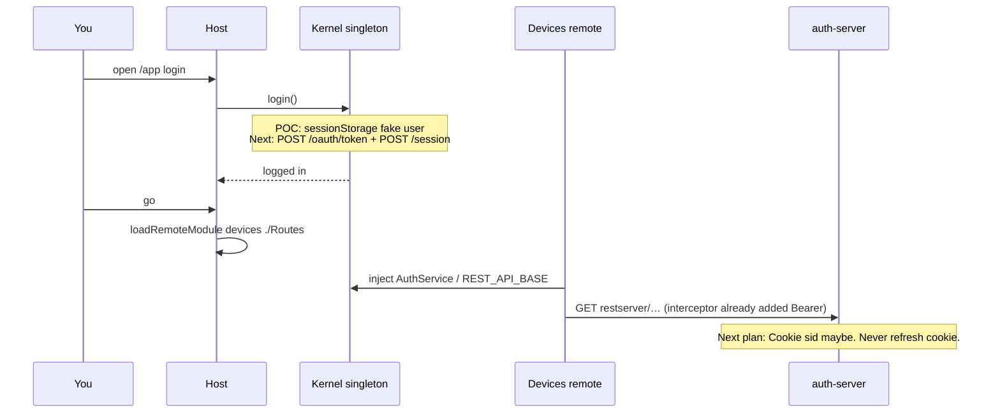

# OneTrust — MFE auth mental model (POC → next: HttpOnly)

**If she asks:** “How will you manage auth in micro-frontends?”  
This file. Deep: [4 MFE](./ONETRUST_MFE_SENIOR_ROUND.md) · [19 auth](./ONETRUST_AUTH_REVISION.md) · [21 HttpOnly](./ONETRUST_HTTPONLY_MFE_AUTH.md) · [23 CI/CD env](./ONETRUST_CICD.md)

**Say:** IDMS NUX conversion POC (Native Federation = Module Federation model). **Do not say** laptop folder names.

---

## 0. The one sentence

> **Auth lives in the kernel, owned by the host. Remotes never log in. They `inject` the same singleton and call APIs. Next we keep that placement and move refresh into HttpOnly cookies.**

POC proves **where** auth sits. HttpOnly is **how** we store secrets. Don’t mix those two answers.

---

## 1. Mental model (draw this)

One **browser tab**. One **page**. Remotes are **not** websites.

```text
  https://idms-qa3.netradyne.com/app/          ← THE page (host origin)
  ┌─────────────────────────────────────────────────────────────┐
  │ HOST (shell)                                                │
  │  login route · layout · megamenu · router outlet            │
  │  #nd-env-config  (hostname → auth-qa3 / idms-qa3)           │
  │  federation.manifest.json  (where remote JS lives)          │
  │                                                             │
  │  KERNEL  ★ singleton  (shared: true)                        │
  │    AuthService · guard · interceptor · tenant               │
  │    “am I logged in?”  “who is the user?”  “put Bearer on”   │
  │           ▲                                                 │
  │           │  inject(AuthService)  inject(REST_API_BASE)     │
  │           │                                                 │
  │  ┌────────┴────────┐     ┌─────────────────┐                │
  │  │ DEVICES remote  │     │ SAFETY remote   │   JS only      │
  │  │ pages + *Api    │     │ pages + *Api    │   same injector│
  │  │ NO login form   │     │ NO token store  │                │
  │  └─────────────────┘     └─────────────────┘                │
  └─────────────────────────────────────────────────────────────┘
```

**Airport:** Host = terminal security. Kernel = your passport in one desk. Remotes = gates. You do not show a new passport at Safety.

**Wrong picture:** Safety is `safety.netradyne.com` with its own login. That would be two origins, two sessions, cookies would not follow. We **load `remoteEntry` as JS on the host page**.

---

## 2. Who does what

| | **Host** | **Kernel (lib)** | **Remote (devices / safety / …)** |
|---|---|---|---|
| Login UI | **Yes** (`/login`) | No | **Never** |
| `POST /oauth/token` + `POST /session` | Calls through kernel | **Owns** the calls | No |
| Access token in memory | — | **Owns** | Read via `inject(AuthService)` if UI needs name/role |
| Refresh / 401 single-flight | Registers interceptor **once** | **Owns** `refreshTokenSubject` | HttpClient just retries |
| Route guard | Host routes use it | `authGuard` lives here | Feature can use `adminGuard` (role), not a second login |
| Env / API host | `#nd-env-config` + `provide REST_API_BASE` | Reads bases | `inject(REST_API_BASE)` + `/tenants/…` |
| Manifest | **Yes** — JS URLs only | No | No REST URLs in manifest |
| Cookies (next plan) | `withCredentials` on HttpClient | Only kernel sets/uses them | **Never** `document.cookie` |

Federation share: `@angular/core`, `rxjs`, **kernel/auth** → `singleton: true`. Two AuthServices = two sessions = contract break.

---

## 3. Three chapters (say the timeline)

```text
  TODAY (prod NUX)          POC (conversion)              NEXT (tell her this)
  ----------------          ----------------              --------------------
  One Angular app           Host + remotes + kernel       SAME placement
  localStorage token+session  Mock login sessionStorage   Real OAuth + session
  OAuthInterceptor          Fake Bearer in demo           Then HttpOnly refresh
  iframe leftover /app      Prove one owner               Access in kernel memory
```

### POC (what you can demo / what conversion proved)

- Host owns login page.
- Kernel `AuthService` is a **fake** user (`admin`/`viewer` or POC email) in **sessionStorage**.
- Remotes `inject(AuthService)` / kernel store — **same user** on Safety and Fleet.
- Interceptor on the **host** `provideHttpClient` — remotes’ `HttpClient` get Bearer because **one injector**.
- **Not** talking to auth-server yet. That’s honest.

### Next plan (real IDMS, then cookies)

**Step A — peel onto the same kernel:** real `AuthenticationService` (password → token → session → interceptor → 401 refresh → idle). Host still `#nd-env-config`. Remotes still only inject.

**Step B — HttpOnly (the security next step):**

```text
  Login (kernel, still two calls)
    POST /oauth/token  →  access A in KERNEL MEMORY
                     →  Set-Cookie refresh=R  HttpOnly  Path=/authserver
    POST /session      →  session row S
                     →  optional Set-Cookie sid=S

  Devices GET /restserver/…
    interceptor (kernel) adds Authorization: Bearer A
    browser may add Cookie: sid
    browser does NOT send refresh  (wrong path)

  401 access dead
    kernel POST refresh  (no R in JS)  browser Cookie: refresh=R
    PUT /session  bind S to new A
    retry Devices — remote does not know refresh happened
```

Remotes **never** touch cookies. XSS in a devices template cannot `localStorage['token']` the refresh. CSRF we design for (SameSite=Lax).

**Spoken ~35s:** “In the MFE POC, auth is a kernel singleton on the host. Remotes inject it; they don’t log in. That’s the placement we’ll keep. Today NUX still uses localStorage for the monolith. Next we wire that kernel to real OAuth and session, then put refresh in an HttpOnly cookie so XSS can’t steal it. Access stays in memory. One interceptor, one refresh flight, every remote’s HttpClient just works.”

---

## 4. Click path (POC → same path later with real APIs)



Logout on host → kernel clears memory (+ cookie logout API later) → every remote sees logged out. No remote-specific logout.

---

## 5. What remotes **share** vs what they **own**

**Share (from kernel / host):**

- Logged-in user, tenant, access token (memory)
- Http interceptor + 401 refresh
- API **bases** (`https://idms-qa3…/restserver/api/v1`)
- Guards for “must be logged in”

**Own (the remote):**

- Screens, routes (`./Routes`)
- Resource paths (`/tenants/{id}/devices`)
- Domain state (device list), not session

**Do not share:** a second `localStorage['token']`, a second env script, REST URLs in the manifest.

---

## 6. Trap answers

| She says | You say |
|---|---|
| Each remote has its own login? | **No.** One kernel. |
| How does Safety get the token? | `inject(AuthService)` — singleton, same tab. |
| Cookie on the remote origin? | Remotes have **no origin**. Scripts on the **host**. |
| Rebuild devices per QA for APIs? | **No.** Host stamp + tokens. [23](./ONETRUST_CICD.md) §6. |
| POC already HttpOnly? | **No.** POC is mock. HttpOnly is **next** on that same kernel. |
| Why kernel not host-only class? | Remotes must import a **shared lib** federated singleton. Host *registers* it. |

---

## 7. Don’t mix

| Topic | File |
|---|---|
| Federation / Nx / deploy | **4** |
| Iframe leftover `/app` | **25** then **18** |
| HttpOnly flags / XSS vs CSRF | **21** |
| Env script / BUILD_ENV | **23** |
