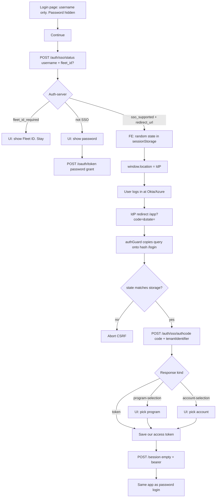
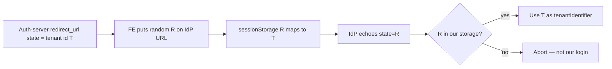

# OneTrust — SSO (IDMS NUX dashboard)

**Round 3.** How **we** do SSO on the dashboard — UI, APIs, diagrams, spoken answers.  
Password / 401 / session: [ONETRUST_AUTH_FLOW.md](./ONETRUST_AUTH_FLOW.md) · [ONETRUST_AUTH_REVISION.md](./ONETRUST_AUTH_REVISION.md).  
OAuth 2 vs JWT: [ONETRUST_OAUTH_JWT_SESSION.md](./ONETRUST_OAUTH_JWT_SESSION.md).

**Do not name** laptop folders. You are **frontend**: check, redirect, `state`, exchange **code**. Auth-server talks to the IdP.

---

## 0. 40s opener

> Some fleets don’t type a password in IDMS. They log in at **their IdP** (Okta, Azure AD, etc.). We use **OAuth 2 authorization code**. Username first → **SSO check** → if SSO, **browser leaves** to the IdP → comes back with a **one-time `code`** → we **POST that code to our auth-server** (we never call Okta’s token URL; no client secret in JS) → we get **our** opaque access token → **same `POST /session`** as password login. Same `Bearer` + `session-key` after that. SSO check is **routing**, not login.

---

## 1. What we are using (say this)

| Piece | What |
|---|---|
| **Protocol** | **OAuth 2 authorization code** (not password grant, not OAuth 1 HMAC) |
| **IdP** | Customer Okta / Azure / etc. User’s password stays **there** |
| **Our auth-server** | SSO config per tenant, IdP redirect URL, **code → our UUID token** |
| **NUX UI** | Username-first wizard: check → maybe fleet → redirect → maybe program/account pickers → session |
| **After success** | Same storage, interceptor, 401 refresh as password users |
| **2FA on SSO** | FE **skips** NUX TOTP (`viaSsoLogin`) — IdP was the other factor (legacy) |

### What is an IdP? Which one do we use?

**IdP** = **Identity Provider**. The system that **owns the user’s password / MFA** and says “this is Alice.” We are the **SP** (service provider): IDMS. We do **not** store Okta passwords.

```text
User  →  IdP (Okta / Azure / Amazon / …)  →  code  →  our auth-server  →  IDMS session
```

**We do not hardcode one IdP for the whole product.** Each **fleet/tenant** has SSO config on auth-server. NUX **Authentication settings** lets admins add **OIDC** (well-known URL) or **SAML**. The well-known URL *is* whatever that customer uses (`https://….okta.com/.well-known/openid-configuration`, Azure AD, etc.). Frontend only follows `redirect_url` from `/auth/sso/status`. We **never** import an “Okta SDK” on the login page.

**What the code actually names:**

| Config / path | Meaning |
|---|---|
| Tenant `UserSSOServiceProvider` | **`DEFAULT`** = generic OpenID (most fleets). **`AMAZON_LAST_MILE`** = Amazon Last Mile (`amazon.netradyne.com`). **`MCKESSON`** = McKesson-specific. Unknown values fall back to the Amazon handler. |
| Dashboard auth settings | **`OIDC`** (well-known or metadata) or **`SAML`** |
| Staging automation | **Okta** SSO tests — Okta is a **real** IdP we integrate via OIDC, not the only one |
| Outbound `/auth/saml` | We can **issue** SAML (IDMS as IdP for some partners). Different from inbound login. |

**Spoken ~20s:** “IdP is the customer’s identity system. We don’t pick one global Okta. Each tenant points us at their OIDC well-known or SAML. Login UI just redirects to whatever URL auth-server returns. Amazon Last Mile and McKesson have dedicated providers; everyone else is default OpenID. Staging uses Okta as an example IdP.”

---

## 2. Whole flow (draw this)



---

## 3. What the UI does (step by step)

### Step A — First paint

- Step name: **`sso-status`**.
- **Username** (+ optional fleet). **Password hidden.**
- Why: don’t look like a phishing password page for SSO fleets; legacy console was username-first.

### Step B — Continue → SSO check

```text
POST {auth}/auth/sso/status
  body: { username, fleet_id? }
  Authorization: Basic client_id:     ← no user Bearer (not logged in)
```

| Reply | UI |
|---|---|
| `fleet_id_required` | Error + **Fleet ID** field (same email, two companies) |
| Not SSO | Step **`password`**: show password, then password grant |
| `sso_supported` + `redirect_url` | **No password.** Prepare redirect |

**Where does `redirect_url` come from?** **Yes — auth-server.** NUX does **not** build the Okta/Azure URL.

```text
Admin saved tenant SSO (OIDC well-known or SAML)
  → auth-server already knows authorization_endpoint (from well-known JSON)

User Continue
  → POST /auth/sso/status { username }
  → JSON: { sso_supported: true, redirect_url: "https://idp.../authorize?client_id=…&redirect_uri=…&state=<our config id>&…" }

FE only:
  swap state for a random nonce
  window.location = that URL
```

Other way in: `GET /auth/sso/getRedirectUrl?ssoConfigId=` (bookmark / deep link) — still **backend** returns the URL.

**Spoken:** “Redirect URL is from the SSO status API. Backend builds it from that tenant’s IdP config. We don’t hardcode Okta.”

### Step C — Leave to IdP

FE (`beginSsoRedirect`):

1. Auth-server `state` on `redirect_url` = **real SSO/tenant id**.  
2. Replace with a **random** `state` for the IdP.  
3. Save random → real id in **sessionStorage** (and legacy `localStorage` for `/console`).  
4. `window.location = IdP`. **Angular is gone.** User sees Okta/Azure, not our form.

### Step D — Come back

IdP `redirect_uri` is often **`/app?code=&state=`** (pathname query). NUX is **hash** routing (`#/login`), so the router might **miss** `code`.

- **`authGuard`:** not logged in + `code` on URL → send **`/login?code=&state=`**.  
- Login page exchanges **once** (code is **single-use**). Strip `code` from the bar after success.

### Step E — Exchange (not password token URL)

```text
POST /auth/sso/authcode
  { code, tenantIdentifier }     ← tenantIdentifier = stored real id, NOT the random state
  client Basic
```

| Kind | UI |
|---|---|
| **`token`** | Save token → `POST /session` |
| **`program-selection`** | Pick program → `POST /auth/sso/program` |
| **`account-selection`** | Pick IDMS account/tenant → `POST /auth/sso/accountSelection` |

Then **same** as password: save session, landing. SSO may omit `refresh_token` until a later refresh; access is enough to start the session.

---

## 4. Why rewrite `state` (CSRF)



If we sent `T` as IdP `state`, an attacker can start a login and **swap** the callback. Random `R` must match **this tab**.

---

## 5. Amazon / deep link (if asked)

- **Amazon:** hostname → `POST /auth/sso/configuration` → different client id on exchange. Still **code in, our token out**.  
- Bookmark with `ssoConfigId` only (no code): `GET /auth/sso/getRedirectUrl` → start redirect like step C.

---

## 6. After SSO vs password

**Same:** `localStorage['token']` + `session`, interceptor Bearer + `session-key`, 401 refresh, idle.  
**Different:** how you **got** the access token (`authcode` vs `grant_type=password`). Rest of NUX must not care.

Interceptor: `/auth/sso/status`, `authcode`, `configuration`, `getRedirectUrl`, `program`, `accountSelection` use **client Basic**, **not** user Bearer — or 401 refresh would fire **during** login.

---

## 7. What FE does **not** do

| Not FE | Who |
|---|---|
| Validate Okta JWT/signature | Auth-server |
| Store client **secret** | Auth-server (would leak in the bundle) |
| HMAC OAuth 1 | We don’t |
| Second session type after success | Same token + session keys |

**Backend hint:** “Auth-server holds per-tenant SSO config, talks to the IdP, turns `code` into **our** OAuth UUID. We orchestrate the browser.”

---

## 8. Interview Qs (answer + why)

**Q: Do you support SSO? How?**  
OAuth 2 **authorization code**. Username → status check → IdP redirect → `code` → our `/auth/sso/authcode` → `POST /session`. Password never hits IDMS for those fleets.

**Q: What is the SSO check?**  
`POST /auth/sso/status`. Decide IdP vs password vs fleet id **before** a password field. Response includes **`redirect_url`** when SSO is on.

**Q: Where do we get the redirect URL?**  
**Auth-server**, not hardcoded in NUX. Status JSON (or `GET /auth/sso/getRedirectUrl`). Built from that tenant’s IdP `authorization_endpoint`. FE only swaps `state` then `window.location`.

**Q: Why not POST `/oauth/token` with the code?**  
Code exchange needs IdP **secret**. Only auth-server. We POST **`/auth/sso/authcode`**. Password grant is a **different** grant for non-SSO users.

**Q: What is `state`?**  
Random CSRF nonce we stored. Callback `state` must match. Real tenant id stays in **our** storage.

**Q: After SSO, different APIs?**  
**No.** Same Bearer + `session-key`.

**Q: Hash router?**  
IdP puts `code` on `/app?...`. Guard copies onto `#/login` or the login page never sees it.

**Q: 2FA after SSO?**  
NUX **skips** TOTP; IdP already authenticated them (legacy). Password users still do TOTP if `twofa_status` is 1/2.

**Q: Fleet ID?**  
Same username in two tenants. Check returns `fleet_id_required`.

**Q: What is IdP? Which IdP?**  
Identity Provider — customer’s login (password/MFA). **Not one global IdP.** Per-tenant OIDC well-known or SAML. Default OpenID; Amazon Last Mile + McKesson special-cased. Staging tests **Okta**. FE only follows `redirect_url`.

---

## 9. Don’t mix

- Password 401 / idle → auth revision / auth flow.  
- “What is OAuth 2 / JWT?” → [ONETRUST_OAUTH_JWT_SESSION.md](./ONETRUST_OAUTH_JWT_SESSION.md).  
- Env hosts → [ONETRUST_ENVIRONMENT_STORY.md](./ONETRUST_ENVIRONMENT_STORY.md).
